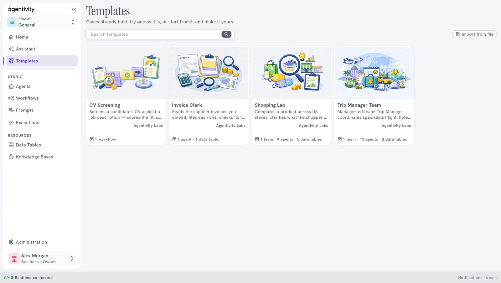
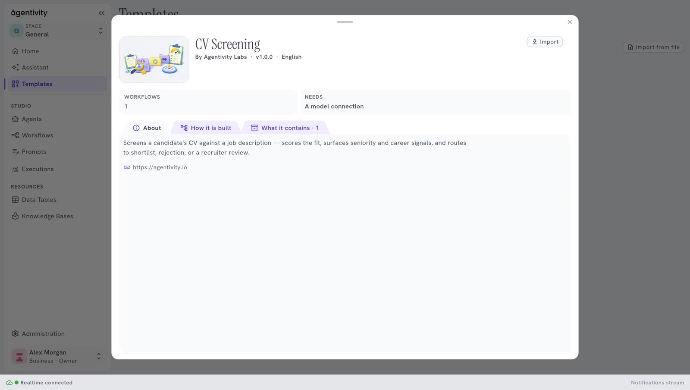

<!-- GENERATED from agentivity_docs/en/studio/templates.md. Do not edit here: edit the source and publish again. -->

**Templates** shows the ready-made solutions that you can add to your workspace. A Template is one file that holds a solution and everything it needs.

## What you need

An internet connection on the machine where Agentivity runs. The list comes from the Agentivity marketplace.

## The list

Each card is a Template. It shows a picture, the name, a short description, its tags, what it contains (for example "1 team · 9 agents · 5 data tables", and the Knowledge Bases too, such as "1 team · 4 agents · 1 knowledge base") and its author.

- **Search templates** finds a Template.
- The buttons under the search field keep only the Templates that have one tag. **ALL** shows everything.

## The window of a Template

Select a card to open it.

The window shows:

- what the Template contains, its version and its language;
- its author and the author's website;
- "Needs a model connection", when the Template needs an AI model;
- **How it is built**: a drawing of the solution, before you import anything.

**Import** adds the Template to your workspace. **Close** goes back to the list.

## Import from a file

When you received a Template as a file:

1. Select **Import from file**, at the top right.
2. Choose the file.
3. Select **Import**.

## After an import

The import creates new copies: nothing you already have is changed. See [Try a ready-made solution](/docs/getting-started/try-a-ready-made-solution/) for the model connection of the imported agents.

## Next step

[The Settings screen](/docs/studio/settings/).
