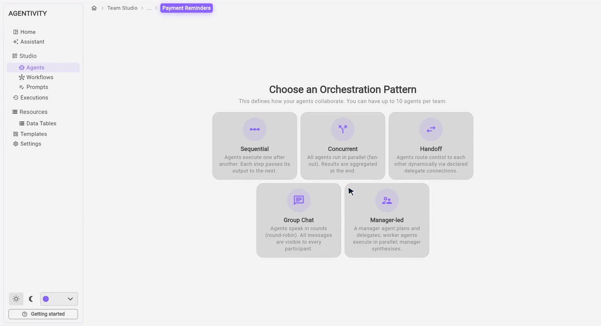
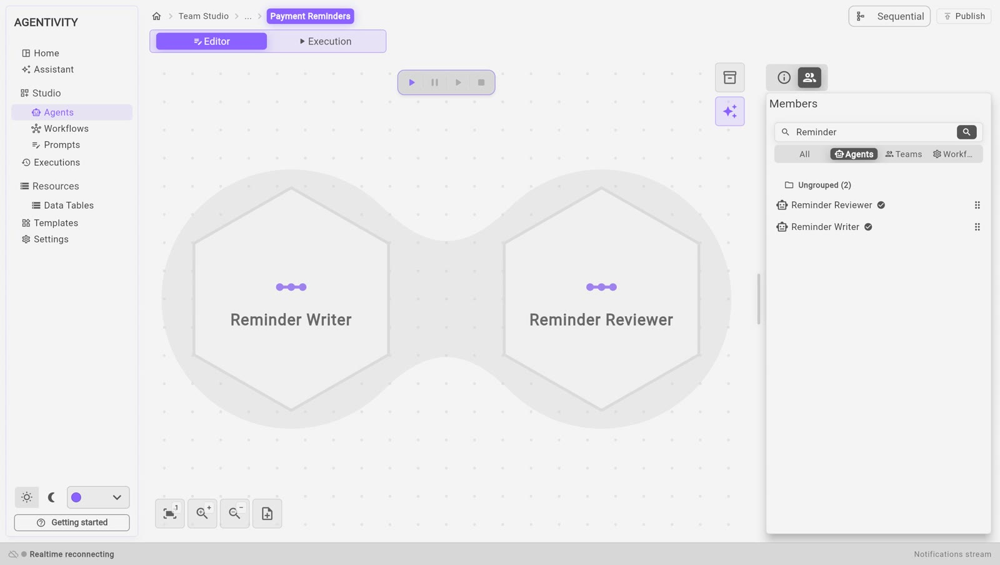

<!-- GENERATED from agentivity_docs/en/teams/create-a-team.md. Do not edit here: edit the source and publish again. -->

A team is several agents that work together on one request. This page builds a team by hand: a writer and a reviewer, who prepare payment reminders one after the other.

<video controls muted playsinline preload="metadata" src="/docs-media/en/teams/images/create-a-team.mp4" aria-label="A recording of the Studio: a team named Payment Reminders is created, the Sequential pattern is chosen, two agents are dragged onto the canvas, and the team is published"></video>

The recording is played faster than real use. To have a team built from a description instead, read [Build your first team with the Assistant](/docs/getting-started/build-your-first-team-with-the-assistant/).

## What you need

- Agentivity running, with the Studio open. See [Install Agentivity with Docker](/docs/getting-started/install-community/).
- At least two agents in your workspace. In this page they are `Reminder Writer` and `Reminder Reviewer`. To create them, see [Create an agent](/docs/agents/create-an-agent/).

## Create the team

1. On the home page, select **Create new team**. You can also open **Studio** > **Agents** and select **New team**.
2. In the window **New team**, type the **Team name**, for example `Payment Reminders`.
3. Select **Create**.

## Choose how the members work together

The Studio asks you to **Choose an Orchestration Pattern**. The pattern is the way the members of the team work together.

1. Select one of the five patterns: **Sequential**, **Concurrent**, **Handoff**, **Group Chat** or **Manager-led**.

For this team, select **Sequential**: the writer works first, then the reviewer receives what the writer produced. The page [Choose how a team works together](/docs/teams/choose-how-a-team-works/) explains the five patterns.

The editor of the team opens. The pattern you chose is shown at the top right, next to **Publish**.

The pattern is saved only when you publish. If you leave before, the Studio asks for the pattern again the next time you open the team.

## Describe the team

In the panel **Info**, on the right:

1. Check the **Name**.
2. Fill in **Role**: one or two sentences on what this team handles. When this team is a member of another team, the role tells the other team when to use it.

## Add the members

1. In the panel on the right, select the second tab. The list **Members** opens. It shows what you can add: your agents, your teams and your workflows. Use **Agents**, **Teams** and **Workflows** to filter the list, or the search field to find a name.
2. Drag `Reminder Writer` from the list onto the canvas. It appears as a hexagon with its name.
3. Drag `Reminder Reviewer` onto the canvas.

In a **Sequential** team, the members work in the order of their positions. To exchange two members, drag one onto the other: they swap places.

A member that is already in the team has a check mark in the list. The same member cannot be added twice.

A long list of members is hard to follow and to check. Start with a few members, each with a clear role, and add more only when you need them.

## Save

1. Select **Publish**, at the top right. This saves your changes.

Publish before you leave the editor. The team editor does not ask you to save when you go to another section, and changes that are not published are lost.

## How to know it worked

- The canvas shows one hexagon per member.
- In **Studio** > **Agents**, the team is in the list, with **Team** in the column **Type**.

## If it does not work

- **"Team name is required."** The name field is empty.
- **The list of members is empty.** You have no agent yet. Import a ready-made solution, or build agents with the Assistant.
- **Publish cannot be selected.** There is nothing new to save.
- **The menu entry Agents does nothing.** You are in an editor of that section. Select **Home** first, then **Studio** > **Agents**.
- **A Manager-led team refuses to run.** It needs a member at the top position, which is the manager, and at least one worker below. See [Choose how a team works together](/docs/teams/choose-how-a-team-works/).

## Go further

- [Name, group and give an icon to team members](/docs/teams/set-up-a-member/)
- [Use a team or a workflow as a member](/docs/teams/put-a-team-in-a-team/)

## Next step

[Run a team and read its work](/docs/teams/run-a-team/).
