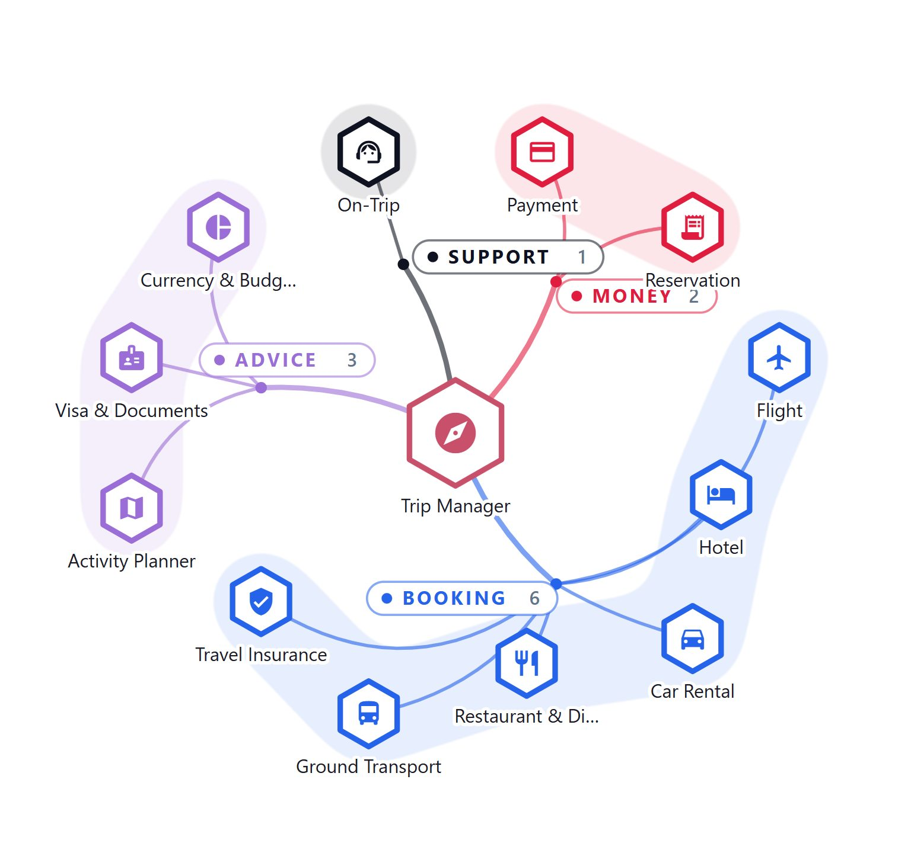

<!-- GENERATED from agentivity_docs/en/teams/organise-with-groups.md. Do not edit here: edit the source and publish again. -->

A group says which part of the work a member or a step belongs to. With groups, a team of thirteen members reads as four parts, and a long workflow reads as four stages. This page explains what groups are for, how to choose good ones, and where to set them.

## What groups give you

- **A large team becomes readable.** You see the parts of the team first, and the members after.
- **You see who does what.** The name of each group, and the number of its members, are on the drawing.
- **You can explain the work to a client.** Four words and four colours say what a workflow does, before anyone looks at a step.
- **Your users see the same thing.** VibeApps and the SDK widgets (React, Flutter, web component) show the same groups, with no code. The delivered Templates CV Screening and Invoice Clerk carry their groups.

Groups organise the drawing. They do not change how a team or a workflow works.

## A group is a name and a colour

The name says the meaning. The colour makes it visible. A colour alone means nothing: the group says what it stands for. A type of step has no colour of its own, so a colour always answers the same question: which part of the work is this?

## Example: a team

Trip Manager Team has a manager and twelve specialists. Its groups follow what the traveller needs:

| Group | Members |
|---|---|
| **Booking** | Flight, Hotel, Car Rental, Restaurant & Dining, Ground Transport, Travel Insurance |
| **Advice** | Activity Planner, Visa & Documents, Currency & Budget |
| **Money** | Payment, Reservation |
| **Support** | On-Trip Assistant |

At a glance, you see that this team is mostly about booking, and where to look for a member.

## Example: a workflow

CV Screening is a long chain of steps. Its groups follow the stages of a recruitment:

| Group | What happens there |
|---|---|
| **Intake** | The workflow asks for the CV and the job description, and reads them. |
| **Analysis** | It structures both, scores the fit and looks for signals. |
| **Human review** | A recruiter looks at the cases that need a person. |
| **Decision** | The workflow applies its thresholds and ends on a result. |

A recruiter who never saw the workflow understands these four words.

## How to choose good groups

- **Name the work, not the tool.** `Booking` says more than `API calls`. `Human review` says more than `Forms`.
- **Use the words of the people who will read it.** Your client's words are better than yours.
- **Keep it short.** Three to six groups read at a glance. If each group has one member, there are too many.
- **Follow the order of the work** in a workflow. Keep the steps of a group next to each other: in the Studio, the background covers everything between them.
- **Keep the same meaning across your solutions.** If human review is red in one workflow, keep it red in the next.
- **Leave out what fits nowhere.** A member or a step can have no group: a step without a group is neutral.

## Do it in a team

Each member picks its group in its own window. Members of a group are drawn together on a coloured background, with the name of the group and how many members it has. If the manager has a group, it sits inside the background of that group.

See [Put members in a group](/docs/teams/set-up-a-member/#put-members-in-a-group).

## Do it in a workflow

Each step picks its group in its settings, in the box **Group**, and **Apply** saves it. The steps of a group get a background behind them and wear the colour of the group.

See [Group the steps](/docs/workflows/create-a-workflow/#group-the-steps).

## Do it for an agent

An agent can have a group and a colour, in the panel **Info**. In a VibeApp, its graph wears them. The canvas of the Studio does not.

See [Give it a group](/docs/agents/create-an-agent/#give-it-a-group).

## Create a group and choose its colour

The gestures are the same everywhere:

1. Type a name. A dashed preview shows it while you type.
2. Press Enter, or select the small arrow, to create it.
3. Select a colour in the list of the palette, or select the square of the colour for any other value.

Details are in [Create a group](/docs/teams/set-up-a-member/#create-a-group) and [Choose a colour](/docs/teams/set-up-a-member/#choose-a-colour).

The theme has no link with these colours, and a palette is only a help to choose: it is not saved.

## Next step

[See the colour palettes on real teams](/docs/teams/see-the-colour-palettes/).
