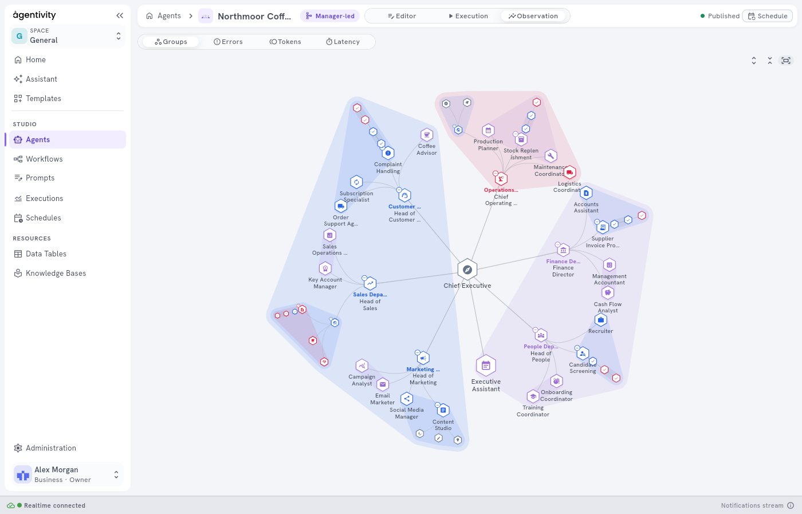
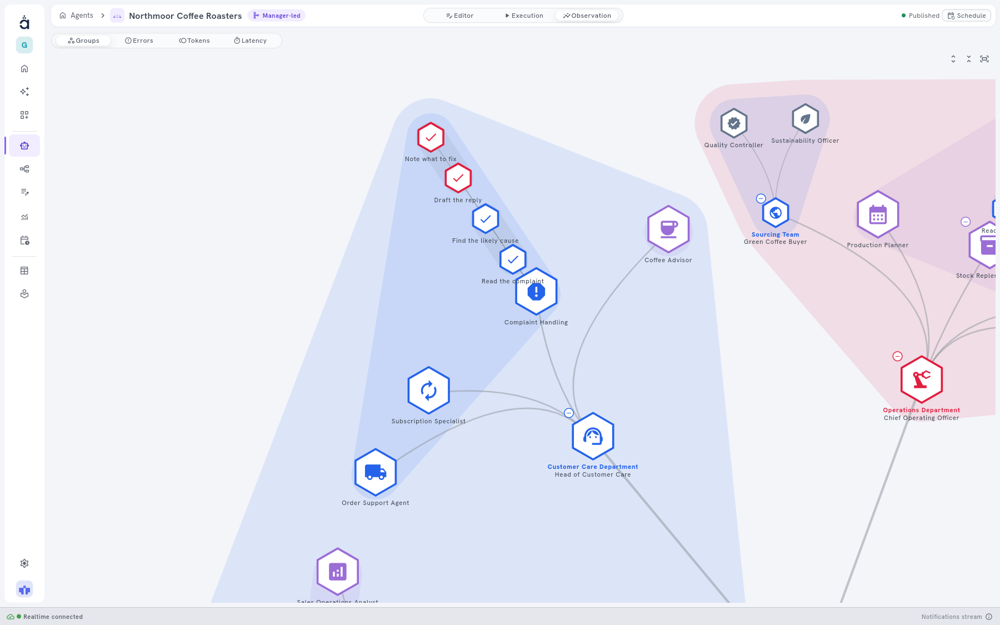

<!-- GENERATED from agentivity_docs/en/teams/read-an-ai-company.md. Do not edit here: edit the source and publish again. -->

An AI Company is a team that holds other teams and workflows: a manager at the top, departments, teams, agents and the steps of workflows. In the tab **Observation** of the Studio, it opens as one organisation, on one screen. This page shows how to read it.

The Studio does this for any team that holds other teams or workflows, however small. To add them, see [Use a team or a workflow as a member](/docs/teams/put-a-team-in-a-team/).

## What you need

- A team that holds at least one team or one workflow, published.
- A plan that offers **Observation**. See [The Observation tab](/docs/studio/observation/).

## Read the structure

1. Open the team in **Studio** > **Agents & Workflows**.
2. In the switch at the top, select **Observation**. The reading **Groups** is selected.

The organisation is drawn in rings around its first manager. The first ring holds the departments, the next one their teams and agents, and the last ones the steps of the workflows. Each branch keeps its angle, so a department stays in one part of the circle, with everything it holds.

In **Groups**, everything is open at the start. Zoom out and levels close by themselves, so the drawing stays readable. Zoom in to read the names.

## Open and close a part

Each team and each workflow has a small **+** or **-** button at its corner. **-** closes it, and **+** opens it.

Three buttons at the top right act on the whole drawing:

| Button | What it does |
|---|---|
| **Open all** | Opens every level. |
| **Close all** | Closes every level. |
| **Back to the whole company** | Frames the whole organisation again. |

## Read a measure

Select **Errors**, **Tokens** or **Latency**, then a period. What each one counts is in [The Observation tab](/docs/studio/observation/).

In a measure, the organisation works differently from **Groups**, so that you go from the whole to the detail:

1. **It starts on the first level.** You see the departments, and each branch shows what it sums.
2. **You open by hand.** Select **+** on the department that stands out. Its teams and agents appear with their own values. Zooming does not open anything.
3. **The colour scale follows what is visible.** The strongest colour is always the highest value on the screen, so you can compare the agents of one department with each other.
4. **What is open stays when you change measure.** Open a department in **Tokens**, then select **Latency**, and you read the same part of the company.

In **Latency**, a branch shows the usual time, not a sum. A department of ten agents does not look slower than a department of two.

## An example: Northmoor Coffee Roasters

Northmoor Coffee Roasters is an example of a whole AI Company: a CEO, six departments, teams, 34 agents and 5 workflows. The pictures of this page show it.

It is a structure to explore, not to run. Its agents have no tools, and it is not a working solution.

## How to know it worked

- The team opens in rings, not as the drawing of the tab **Editor**.
- Each team and each workflow has its **+** or **-** button.
- In a measure, **+** on a branch shows what the branch holds, and the colours change to fit.

## Good to know

- This view is in the Studio only, not in VibeApps or the SDKs.
- To choose the zones and their colours, see [Organise a team or a workflow with groups](/docs/teams/organise-with-groups/) and [See the colour palettes on real teams](/docs/teams/see-the-colour-palettes/).

## Next step

[The Observation tab](/docs/studio/observation/), for the card of a member and the periods.
