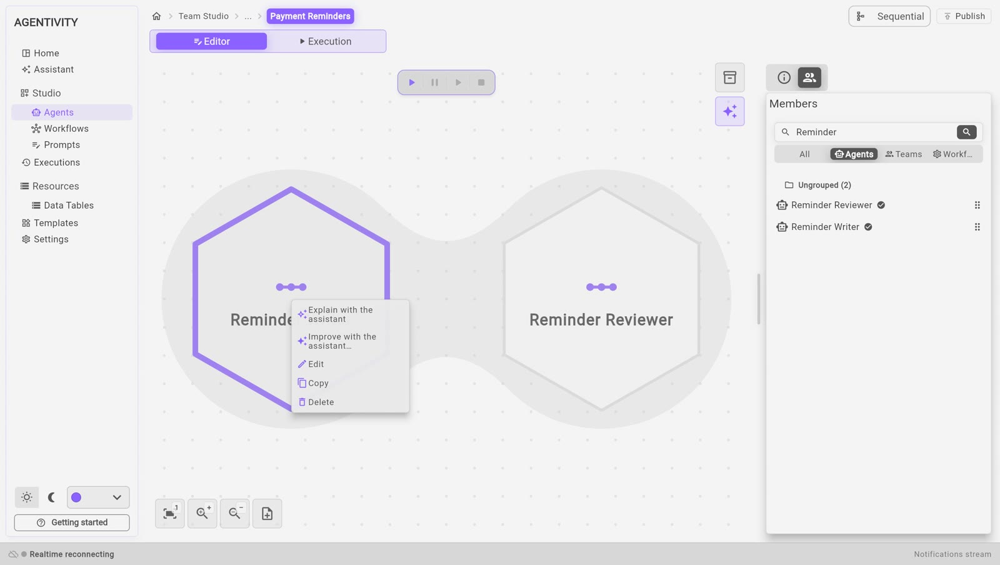
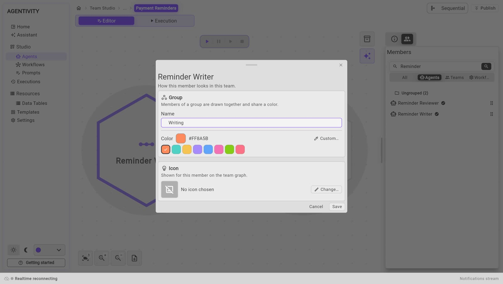
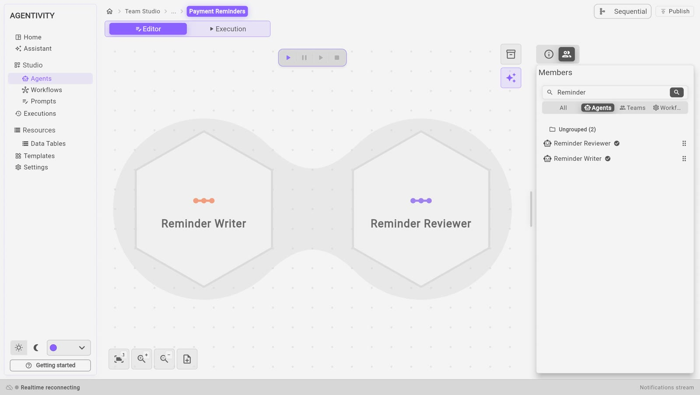

<!-- GENERATED from agentivity_docs/en/teams/set-up-a-member.md. Do not edit here: edit the source and publish again. -->

A team of a dozen members is hard to read when it is only a dozen hexagons. Put the members in groups, and you see at once who does what: the parts of the team show on the drawing, here and in the VibeApp you deliver. Each member can also have its own icon. This organises the drawing only: it does not change how the members work. It does not change what a member gives to the team either: its answer, and its named outputs. See [Use a team or a workflow as a member](/docs/teams/put-a-team-in-a-team/).

The name of a member is shown in the answer of a **Concurrent** team: each answer comes after the name of its member.

## What you need

- A team open in its editor, with its members. See [Create a team of agents](/docs/teams/create-a-team/).

## Open the window of a member

1. On the canvas, right-click the hexagon of the member.
2. Select **Edit**.

A window opens with the name of the member and the line "How this member looks in this team."

The same menu has **Copy**, **Delete**, and two entries that open the Assistant on this member.

## Put members in a group

A group says which part of the work a member belongs to. In a team that follows unpaid invoices: one group `Writing`, one group `Checks`. Members of a group are drawn together, in the colour of the group, with its name and the number of its members. The colour is there to carry this meaning. To choose good groups, see [Organise a team or a workflow with groups](/docs/teams/organise-with-groups/).

1. In the window of the member, under **Group**, type the name of the group in **Name**, or select a group in the list **Groups in this team**.
2. Choose the colour of the group. See [Choose a colour](#choose-a-colour).
3. Select **Save**.
4. Do the same for each member of the group. Select the group in the list, or type the same name: capital letters do not matter.

Leave **Name** empty for a member that belongs to no group.

The colour belongs to the group: change it from one member, and it changes for all the members of the group. A group with no colour chosen takes a default colour.

## Create a group

1. Type the name of the new group in **Name**, up to 32 characters. It appears in the list with a dashed outline.
2. Press Enter, select the small arrow in the field, or select the dashed group. The group is created.

To delete a group you have just created, right-click it and select **Delete**. This works only while nothing uses the group. A group in use cannot be deleted: its menu says **Delete (in use)**.

Typing another name for a member moves this member to that group. It does not rename the group: the other members stay where they are.

## Choose a colour

Once the group has a name, a line appears below the list: on the left a square with the colour of the group, on the right the list of palettes.

1. Open the list of palettes. There are 24, in families: Modern, Corporate, Soft, Futurist and others. The first one is **Modern — Red Blue Mauve**.
2. Select a colour directly in the list.

For any other colour, select the square. It opens a colour picker and the field **Hex**, for a value such as `#2563EB`.

A palette only proposes colours. It is never saved: what is saved is the colour you chose. To compare them on real teams, see [See the colour palettes on real teams](/docs/teams/see-the-colour-palettes/).

## Give a member an icon

1. In the window of the member, under **Icon**, select **Change…**
2. Choose an icon.
3. Select **Save**.

The icon is shown on the hexagon of this member, in this team. The same agent can have another icon in another team.

## Remove a member

1. Right-click the hexagon.
2. Select **Delete**.

This removes the member from the team. The agent itself stays in your workspace.

## Save

Select **Publish**, at the top right.

## How to know it worked

On the canvas, the hexagons of a group take its colour, and the members of a group are drawn together on a soft tint, with the name of the group. The manager is in the zone of its group, or in a zone of its own when that zone would pass over other members. Each member shows its icon.

## Next step

[Use a team or a workflow as a member](/docs/teams/put-a-team-in-a-team/).
