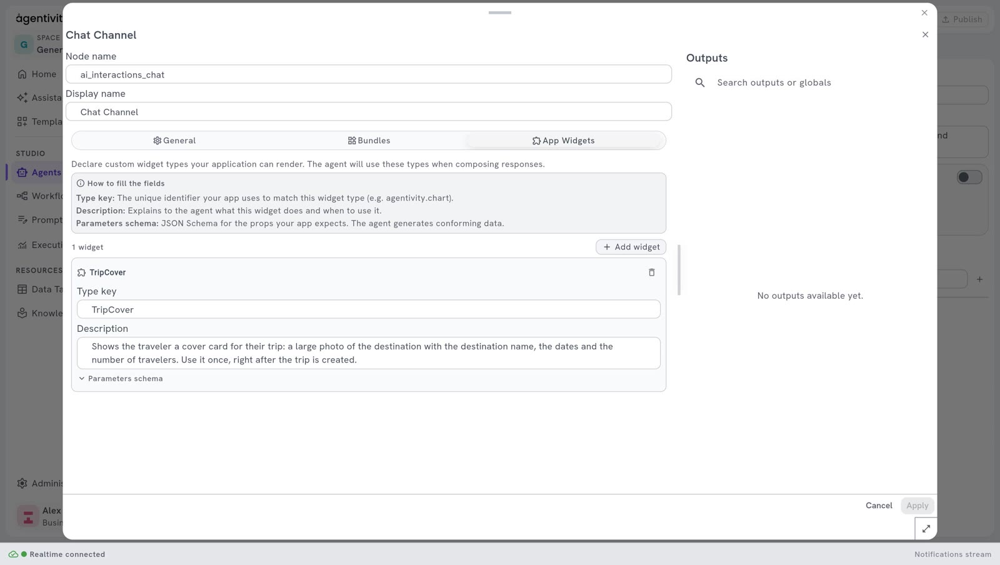

<!-- GENERATED from agentivity_docs/en/vibeapps/add-your-own-widgets.md. Do not edit here: edit the source and publish again. -->

This page is for developers. A custom widget is a screen of your own that an agent can put in the conversation. The agent fills it in. The person answers in it. It is the part that turns a conversation into an application made for one job.

## What it makes possible

The Trip Planner example has three custom widgets. They show what the idea is for.

| Widget | What the person sees | Why a ready-made widget was not enough |
|---|---|---|
| `HotelChoice` | Up to three hotels as cards, each with photos, a price, a reason and a "recommended" mark. One click chooses. | A plain list of options has no photos and no price layout. |
| `PaymentCard` | The total, the lines of the bill, the card on file, and a button to pay. The payment is simulated. | A confirmation card knows nothing about an amount or a card. |
| `TripCover` | A large photo of the destination, with the dates and the number of travellers. It asks nothing. | It gives the conversation the look of a travel application. |

In each case the agent sends only facts: names, prices, dates. The widget decides how they look. The agent never sends a picture address: `HotelChoice` looks for photos itself.

Other uses of the same idea: an order summary to approve, a seat map, a quote with editable lines, a signature box, a map with a point to confirm.

## The two halves

A custom widget has two halves that share one name.

| Half | Where | What it says |
|---|---|---|
| **The declaration** | In the Studio, on the Chat Channel of the agent | The name of the widget, when to use it, and what content it expects. |
| **The component** | In your application | How to draw that content, and what to send back. |

## What you need

- A conversation that works, with the ready-made widgets. See [The widgets an agent can show](/docs/vibeapps/the-widgets-an-agent-can-show/).
- An agent with a **Chat Channel**. See [Let an agent ask a person before it decides](/docs/agents/let-an-agent-ask-a-person/).

The example below adds a widget named `ReminderPreview` to the agent `Reminder Writer`. It shows the payment reminder as an e-mail, with two buttons: approve, or ask for changes.

## 1. Declare the widget in the Studio

1. Open the agent in **Studio** > **Agents**.
2. Right-click its **Chat Channel** and select **Edit**.
3. Select the tab **App Widgets**, then **Add widget**.



4. Fill in the three fields:

| Field | What to enter | In the example |
|---|---|---|
| **Type key** | The name of the widget. Your application uses the same name. | `ReminderPreview` |
| **Description** | What the widget does and when to use it. The agent reads this to decide. | `Shows the customer reminder as an e-mail and lets the person approve it or ask for changes. Use it once the reminder is written. The reply is the decision.` |
| **Parameters schema** | The content the widget expects, as a JSON Schema. The agent produces content that matches it. | See below. |

```json
{
  "type": "object",
  "properties": {
    "customer": { "type": "string", "description": "Name of the customer." },
    "subject": { "type": "string", "description": "Subject line of the e-mail." },
    "body": { "type": "string", "description": "Text of the e-mail." }
  },
  "required": ["customer", "subject", "body"]
}
```

5. Select **Apply**, then **Publish**.

## 2. Tell the agent when to use it

Add one sentence to the instructions of the agent:

```text
When the reminder is ready, show it with the ReminderPreview widget and wait for the decision. If the person asks for changes, rewrite it and show it again.
```

The description of the widget says what it is. The instructions say when it comes in the work.

## 3. Build the component

The component receives the content as props. A widget that asks also receives a function named `__onSubmit`: call it with a text, and that text goes back to the agent as the answer of the person.

```tsx
export function ReminderPreview(props: Record<string, unknown>) {
  const onSubmit = typeof props['__onSubmit'] === 'function' ? (props['__onSubmit'] as (answer: string) => void) : undefined;

  return (
    <div className="reminder-preview">
      <p>To: {String(props.customer ?? '')}</p>
      <h3>{String(props.subject ?? '')}</h3>
      <p>{String(props.body ?? '')}</p>
      <button disabled={!onSubmit} onClick={() => onSubmit?.('Approved. Send it.')}>
        Approve
      </button>
      <button disabled={!onSubmit} onClick={() => onSubmit?.('Please make it shorter and more friendly.')}>
        Ask for changes
      </button>
    </div>
  );
}
```

The content comes from an AI model. Read each value with care, as the example does: a field can be missing.

## 4. Register it under the same name

Add your widget to the ready-made ones, and give the result to the chat.

```tsx
import { ChatDiscussion, buildArtifactsBundle } from '@agentivity-labs/sdk-react';
import { ReminderPreview } from './ReminderPreview';

const widgetRegistry = buildArtifactsBundle({
  ReminderPreview: (props) => <ReminderPreview {...props} />,
});

<ChatDiscussion controller={controller} onSend={handleSend} onHilResponse={handleHilResponse} widgetRegistry={widgetRegistry} />;
```

The name on the left must be the **Type key** of the Studio, letter for letter.

## A widget that only shows

By default, the chat treats a custom widget as a question. Once it is answered, or once the conversation moves on, it is dimmed and its buttons stop responding.

That is wrong for a widget the person only looks at: a cover, a report, a result with links. Wrap it in `displayWidget`, and it stays in full colour and usable.

```tsx
import { buildArtifactsBundle, displayWidget } from '@agentivity-labs/sdk-react';

const widgetRegistry = buildArtifactsBundle({
  TripCover: displayWidget((props) => <TripCover {...props} />),
});
```

## Replace a ready-made widget

Register your component under the name of a ready-made widget, for example `ChoiceCard`, and yours is used instead. Nothing changes in the Studio.

## How to know it worked

1. Run the agent from your application.
2. When the reminder is ready, your widget appears in the conversation, filled in.
3. Select a button. The agent continues with your answer.

## If it does not work

- **The agent answers with text, and no widget.** Check the instructions: name the widget and the moment. Check that the widget is declared on the Chat Channel of this agent, not of another member of the team.
- **Nothing is drawn where the widget should be.** The name in your application is not the **Type key**. Check the capital letters.
- **The widget is empty or half filled.** Make the descriptions in the schema more precise, and list the fields the agent must always give in `required`.
- **The buttons do nothing.** The widget is no longer the open question. Only the last question can be answered.

## Good to know

- **A widget is declared per agent.** In a team, each member has its own Chat Channel, and its own widgets. In the Trip Planner, `HotelChoice` belongs to the Hotel Specialist, and `PaymentCard` to the Payment Agent.
- **The answer is a text.** Write it as a person would: "I choose: Hotel du Parc, 140 euros a night." The agent reads it like a typed message.
- **The Studio does not draw your widget.** In the **Execution** view of the Studio, only your application knows the component. Test a custom widget from your application.
- **Do not put a secret or a real payment in a widget.** The Trip Planner payment is a simulation. A real payment belongs to a payment provider, on your own server.

## Where to read more

The three widgets of the Trip Planner are short, and each starts with a comment that explains it: `src/widgets` in `agentivity_sdk_showcase_tripagency`.

## Next step

[Give the app your brand](/docs/vibeapps/give-it-your-brand/).
