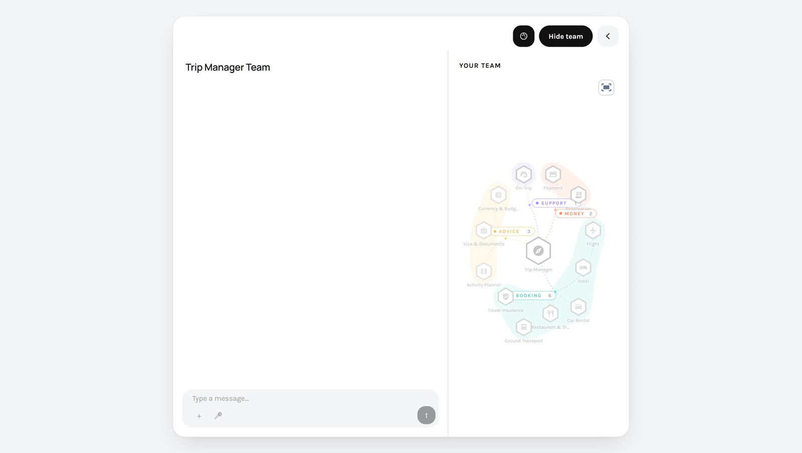

<!-- GENERATED from agentivity_docs/en/vibeapps/show-the-team-at-work.md. Do not edit here: edit the source and publish again. -->

This page is for developers. A person trusts a team more when they see who is working. The SDK draws the team, or the workflow, from what is saved in the Studio, and lights it up during an execution.



## What you can show

| Component | What it shows | Use it for |
|---|---|---|
| `TeamRoster` | The members in a row: an icon each, and who is working or done. | A compact line above the conversation. |
| `TeamGraph` | The team as a drawing, in the shape of its pattern: a manager and its specialists, a chain, a group. | A side panel next to the conversation. |
| `WorkflowGraph` | The steps of a workflow and their links. The view follows the step that runs. | The same, when the solution is a workflow. |
| `TemplateGraph` | A team or a workflow drawn from a Template file alone, with no execution. | A catalogue, a preview, a page that presents a solution. |

Nothing about the team is written in your application. The members, their icons and their groups come from the team editor. Change the team in the Studio, and the drawing follows.

## What you need

- A conversation that works. See [List solutions and start an execution from your app](/docs/vibeapps/run-a-solution-from-your-app/).
- The `controller` and the `executionId` of that page.

## A starting point

Three things are needed: the team as it is saved, the state of each member during the execution, and the component.

```tsx
import { useEffect, useMemo, useState } from 'react';
import {
  TeamGraph,
  TeamRoster,
  teamHubMemberId,
  teamMembersFromStructure,
  useAgentivityClient,
  useExecutionStatuses,
  type ChatController,
  type TeamStructure,
} from '@agentivity-labs/sdk-react';

export function TeamPanel({ teamId, executionId, controller }: { teamId: string; executionId?: string; controller: ChatController }) {
  const client = useAgentivityClient();

  // 1. The team as saved in the Studio.
  const [team, setTeam] = useState<TeamStructure>();
  useEffect(() => {
    client.entities.fetchTeam(teamId).then(setTeam);
  }, [client, teamId]);
  const members = useMemo(() => (team ? teamMembersFromStructure(team) : []), [team]);

  // 2. Who is working, and who is done.
  const { members: statuses } = useExecutionStatuses(executionId, { controller });

  // 3. The drawings.
  return (
    <>
      <TeamRoster controller={controller} members={members} statuses={statuses} />
      <TeamGraph controller={controller} members={members} hubMemberId={team ? teamHubMemberId(team) : undefined} statuses={statuses} />
    </>
  );
}
```

For a workflow, the shape is the same: `client.entities.fetchWorkflowGraph(id)` gives the structure, and `WorkflowGraph` takes it in `structure`, with the `nodes` part of the statuses.

## Good to know

- **The state comes from the server, not from the stream.** `useExecutionStatuses` reads the state of the execution from the server. So the drawing is right on a new execution, after a lost connection, and when a person reopens an old conversation.
- **The same hook says whether an execution is in progress.** It returns `running`. Give it to `ChatDiscussion` to show the stop button at the right time.
- **The icons and colours are those of the team editor.** To use your own pictures, give a function in `resolveMemberAvatar`.
- **The drawing takes the width you give it** and sets its own height. Put it in a column.

## Draw a solution without running it

`TemplateGraph` needs no server and no execution. Give it a Template file, and it draws the team or the workflow inside.

```tsx
import { TemplateGraph } from '@agentivity-labs/sdk-react';
import '@agentivity-labs/sdk-react/styles.css';

<TemplateGraph source={template} autoplay />;
```

`autoplay` lights the members up one after the other, as an execution would. It does not play for a visitor who asked their system for less motion.

For a page that is not built with React, the SDK also builds one script with a ready-made element, `agentivity-graph`. See `scripts/build-standalone.mjs` in the SDK.

## Where to read more

- `src/screens/TripChat.tsx` in the Trip Planner: a roster above the chat, and a team panel that opens beside it or as a screen of its own on a phone.
- `src/App.tsx` in the portal: the choice between the team view and the workflow view.
- The section "Graphs from JSON" of the README of the SDK, for every option of `TemplateGraph`.

## Next step

[The widgets an agent can show](/docs/vibeapps/the-widgets-an-agent-can-show/).
