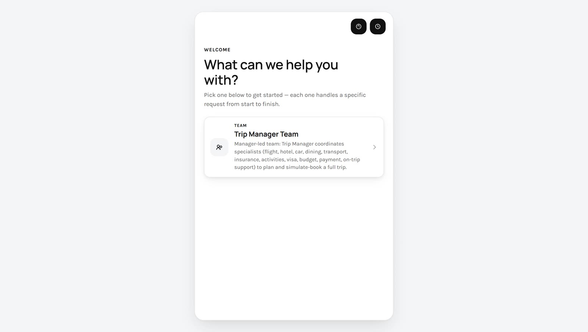

<!-- GENERATED from agentivity_docs/en/vibeapps/start-with-the-react-sdk.md. Do not edit here: edit the source and publish again. -->

This page is for developers. The fastest way to start is to run the portal example against your own server, then change it.

## What you need

- Agentivity running. See [Install Agentivity with Docker](/docs/getting-started/install-community/). For a hosted workspace, read [Connect a VibeApp to a hosted workspace](/docs/vibeapps/connect-a-vibeapp-to-a-hosted-workspace/) after this page.
- At least one solution with the tag `solution`. See [Show a team in the portal](/docs/vibeapps/show-a-solution-in-the-portal/).
- Node.js and git on your machine.

## Get the SDK and the portal

The portal example expects the SDK in the folder next to it. Clone both into the same parent folder.

```bash
git clone https://github.com/agentivity-labs/agentivity_sdk_react.git
git clone https://github.com/agentivity-labs/agentivity_sdk_showcase_solutions.git
```

The package `@agentivity-labs/sdk-react` is not on the npm registry yet. Until it is, use it from the cloned folder, as the portal does.

## Build the SDK

```bash
cd agentivity_sdk_react
npm install
npm run build
```

## Set the address of your server

In the folder `agentivity_sdk_showcase_solutions`, create a file named `.env.local` with one line. It gives the address through which the application reaches Agentivity.

```text
VITE_AGENTIVITY_BASE_URL=http://localhost:5005
```

The portal runs on its own port, and the server accepts calls from any page by default. So you can give the address of Agentivity directly, with nothing else to set.

This is for developing, on your machine or on a network you trust. Before you put an application online, limit the pages that may call the server. See [Before you put a VibeApp online](/docs/vibeapps/before-you-put-it-online/).

## Start the portal

```bash
cd agentivity_sdk_showcase_solutions
npm install
npm run dev
```

Open the portal through the shared address.

## How to know it worked

The welcome screen lists your solutions, one card each. Select a card: the conversation opens, and for a team, the team is drawn on the right.



## Make it yours

One file holds what you change for your own portal: `src/config.ts`.

| Setting | What it is |
|---|---|
| `brandName` | The name shown in the header and in the browser tab. |
| `logoUrl` | The address of a logo, shown instead of the name. |
| `themeId` | The default look, among the themes of the portal. |
| `solutionTags` | The tags that mark what the portal lists. |
| `tagMode` | `any` lists what carries at least one of the tags. `all` lists only what carries every tag. |

## The SDK in your own application

In an application of your own, wrap your components in the provider of the SDK and give it the address of the server.

```tsx
import { AgentivityProvider } from '@agentivity-labs/sdk-react';
import '@agentivity-labs/sdk-react/styles.css';

export function App() {
  return (
    <AgentivityProvider baseUrl="https://agentivity.example.com">
      <YourScreens />
    </AgentivityProvider>
  );
}
```

The SDK needs React 18 or later.

## If it does not work

- **The welcome screen is empty.** No entity carries the tag the portal looks for. Check `solutionTags` and the tags in the Studio.
- **The browser console shows blocked calls.** The server was started with the setting `Cors__AllowedOrigins`, and the address of the portal is not in its list. Add it, or remove the setting while you develop. See [Who can call the API](/docs/getting-started/install-community/#who-can-call-the-api).
- **`npm install` fails in the portal.** The folder `agentivity_sdk_react` is not next to it, or it was not built.

## Next step

[List solutions and start an execution from your app](/docs/vibeapps/run-a-solution-from-your-app/).
