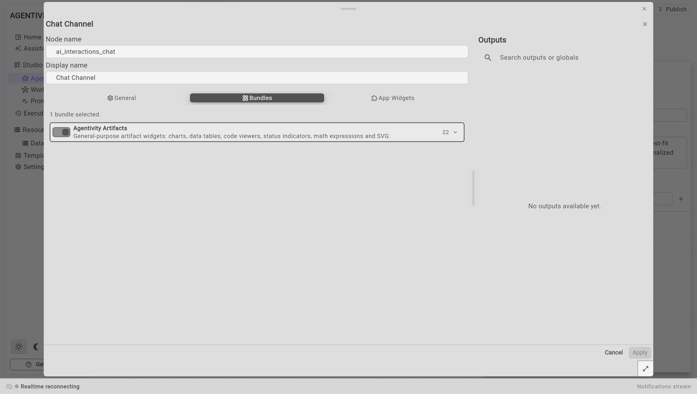

<!-- GENERATED from agentivity_docs/en/vibeapps/the-widgets-an-agent-can-show.md. Do not edit here: edit the source and publish again. -->

This page is for developers. An agent does not only write text. It can put a chart, a form or a choice in the conversation. These pieces are named widgets. The SDK has twenty-two, and your application shows them with one line.

This is what makes a VibeApp more than a chat window: the run decides which screen comes next.

## How it works

1. **In the Studio, the Chat Channel of the agent says which widgets exist.** A group of widgets is named a bundle. The bundle **Agentivity Artifacts** holds the twenty-two widgets, and it is on by default.
2. **During a run, the agent chooses.** Each widget has a description that tells the agent when to use it. The agent fills in the content: the bars of a chart, the options of a choice.
3. **Your application draws it.** The SDK has the matching component for each name.
4. **If the widget asks something, the person answers in it,** and the answer goes back to the agent like a typed message.



To see this in the Studio: open an agent, right-click its **Chat Channel**, select **Edit**, then the tab **Bundles**.

## The twenty-two widgets

Widgets that show something:

| Widget | Use it for |
|---|---|
| `BarChart` | Comparing amounts across a few categories. |
| `LineChart` | A value that changes over time. |
| `AreaChart` | Cumulative or stacked values over time. |
| `PieChart` | The share of each part in a whole. |
| `RadarChart` | Comparing items across several criteria. |
| `MetricCard` | One key number, with its trend. |
| `StatGrid` | Several key figures at a glance. |
| `KeyValue` | The details of one item: a record, an order, a profile. |
| `CodeBlock` | Code, a query or a configuration to copy. |
| `JsonViewer` | Structured data with no better layout. |
| `StatusCard` | The outcome of an action: success, warning, error. |
| `Timeline` | A sequence of dated events or steps. |
| `Latex` | A formula. |
| `Svg` | A simple diagram or illustration. |
| `ImageGallery` | Pictures with captions and links: products, places. |
| `SummaryCard` | A recap of what is about to happen, before a confirmation. |

Widgets that ask the person, and wait for the answer:

| Widget | Use it for |
|---|---|
| `QuestionForm` | Several questions at once. |
| `ChoiceCard` | One or several options to pick. |
| `ConfirmCard` | Confirm or cancel, before an action that cannot be undone. |
| `RatingCard` | A rating, with stars or a scale. |
| `DatePickerCard` | A date or a range of dates. |
| `SourceInput` | A document: the person uploads a file, gives a link or pastes a text. |

## Show them in your application

Give the ready-made widgets to the chat. One line:

```tsx
import { ChatDiscussion, buildArtifactsBundle } from '@agentivity-labs/sdk-react';
import '@agentivity-labs/sdk-react/styles.css';

const widgetRegistry = buildArtifactsBundle();

<ChatDiscussion controller={controller} onSend={handleSend} onHilResponse={handleHilResponse} widgetRegistry={widgetRegistry} />;
```

`controller`, `handleSend` and `handleHilResponse` are those of [List solutions and start a run from your app](/docs/vibeapps/run-a-solution-from-your-app/).

## Make the agent use the right widget

The agent decides, so you guide it in its instructions, in the Studio. Say when to use a widget, in plain words. Two examples from the showcases:

- Invoice Clerk asks for the invoice with a `SourceInput`, and its instructions say so in the first step.
- The Report Writer of Shopping Lab is asked for a report with price and radar charts.

A good instruction names the widget and the moment: "Show the totals by category with a `BarChart` after each invoice."

## Good to know

- **A widget that asks is answered once.** After the answer, it stays in the conversation, dimmed, and its buttons no longer respond.
- **A widget that shows stays usable.** Its links keep working for the whole conversation.
- **The widgets follow your theme.** See [Give the app your brand](/docs/vibeapps/give-it-your-brand/).
- **Turn the bundle off** in the tab **Bundles** if an agent must answer with text only.

## When the ready-made widgets are not enough

A confirmation card does not know what a payment is. A choice card does not show hotel photos. For a screen of your own, see [Add your own widgets](/docs/vibeapps/add-your-own-widgets/).

## Next step

[Add your own widgets](/docs/vibeapps/add-your-own-widgets/).
