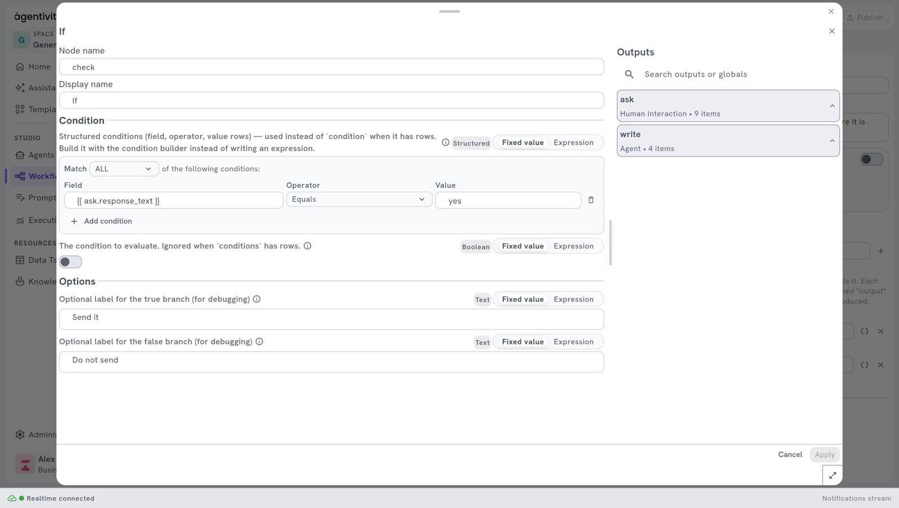
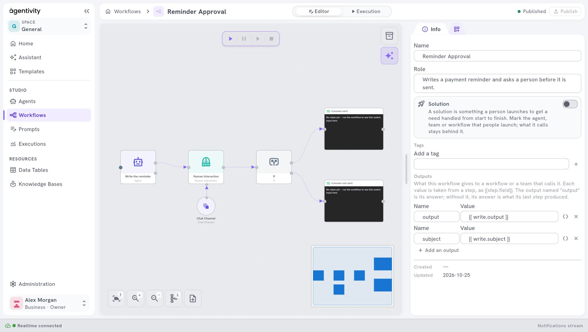

<!-- GENERATED from agentivity_docs/en/workflows/add-a-condition.md. Do not edit here: edit the source and publish again. -->

A condition lets a workflow take one path or another. The rule is fixed: the same input always takes the same path. This page adds an **If** step.

## What you need

- A workflow open in its editor, with at least one step that produces a value to test. See [Create a workflow](/docs/workflows/create-a-workflow/).

## Add the If step

1. In the **Nodes catalog**, open **Core**, then **Control Flow**.
2. Drag **If** onto the canvas.
3. Link the step before it to **If**: drag from the dot on the right of that step to the dot on the left of **If**.

Link the step first. The window of **If** can then show the outputs of the earlier steps.

## Build the condition

1. Right-click **If** and select **Edit**.
2. Under **Condition**, select **Add condition**. A condition is one row: a **Field**, an **Operator** and a **Value**.
3. In **Field**, type the reference of the output you want to test. A reference is the name of the step, a dot and the name of the output, written between two pairs of curly braces. The panel **Outputs**, on the right, lists the outputs of the earlier steps with their exact names. For the answer of a person, the output is `interaction_human.response_text`.
4. In **Operator**, keep **Equals**.
5. In **Value**, type `yes`.
6. Add more rows if you need them. The list **Match** says how the rows are combined: with **ALL**, every row must be true; with **ANY**, one true row is enough.
7. Select **Apply**.

The operators are: **Equals**, **Not equals**, **Contains**, **Does not contain**, **Starts with**, **Ends with**, **Greater than**, **Greater or equal**, **Less than**, **Less or equal**, **Is empty**, **Is not empty**, **Is true** and **Is false**.

Until you add a row, the window says: "No conditions yet — this node will always take the "false" branch until you add one."

## Link the two paths

**If** has two exits, drawn as two dots on its right side: **True** and **False**.

1. Link the exit **True** to the step that runs when the condition is true.
2. Link the exit **False** to the step that runs when it is not.
3. Select **Publish**.

## How to know it worked

When you [run the workflow](/docs/workflows/run-a-workflow/), only one of the two paths runs. In the **Execution** view, the steps of the other path stay not started.

## If it does not work

- **The workflow always takes the path False.** The condition has no row, or the value does not match exactly. Open the execution, select the step before **If** in the **Inspector**, and read what it really produced.
- **The window shows no output to choose from.** **If** is not linked to an earlier step.

## Other steps that control the path

The same category, **Control Flow**, has other nodes:

| Node | What it does |
|---|---|
| **Switch** | Tests one value and takes one path among several, one per case. |
| **For Each** | Repeats the steps linked to it for each item of a list. |
| **First Of** | Takes the first value that arrives among several inputs. |

## Next step

[Repeat steps for each item of a list](/docs/workflows/repeat-steps/).
