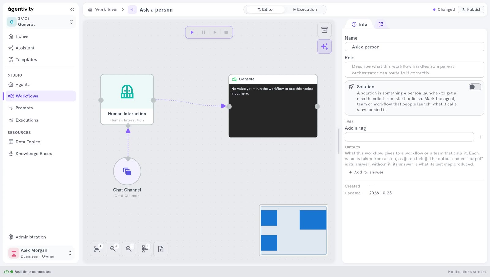
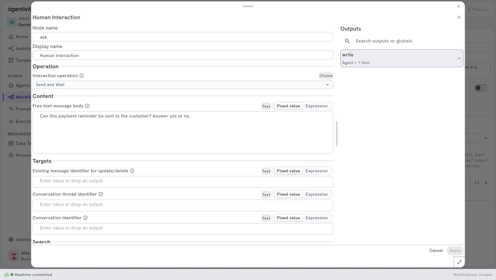

<!-- GENERATED from agentivity_docs/en/workflows/ask-a-person-to-decide.md. Do not edit here: edit the source and publish again. -->

Some decisions must stay with a person. This page adds a step that stops the workflow, asks a question, and continues only when a person has answered.

## What you need

- A workflow open in its editor. See [Create a workflow](/docs/workflows/create-a-workflow/).

## Add the step and its channel

The step needs two nodes: the question, and the channel that carries it to the person.

1. In the **Nodes catalog**, open **Interactions** and drag **Human Interaction** onto the canvas.
2. Open **AI**, then **Interactions**, and drag **Chat Channel** onto the canvas, below the first node. **Chat Channel** is the chat inside the Studio. It appears as a circle.
3. Drag from the diamond of **Chat Channel** to the diamond under **Human Interaction**. A dotted line links them, with the label **Channel**.
4. Link **Human Interaction** to the step that must run after the answer.



## Write the question

1. Right-click **Human Interaction** and select **Edit**.
2. In **Interaction operation**, choose **Send and Wait**. With **Send**, the workflow sends the message and does not wait.
3. In **Free-text message body**, write the question. For example:

   ```text
   Can this payment reminder be sent to the customer? Answer yes or no.
   ```

4. Select **Apply**.
5. Select **Publish**.



## What happens when the workflow runs

1. The workflow reaches the step and stops. At the top right of the **Execution** view, the state is **Waiting for input**, followed by the name of the step, for example **Waiting for input: ask**.
2. The question is sent to the chat of the execution. In the **Execution** view, open the tab **Chat**, in the panel on the right.
3. Type the answer in the field **Type your response…** and select **Send response**.
4. The workflow continues with the next step.

An execution that waits can wait for a long time: the workflow is paused, and it continues when the answer arrives.

## Use the answer in the next steps

The step produces outputs that the next steps can use:

| Output | What it holds |
|---|---|
| `response_text` | The answer of the person. |
| `outcome` | The result of the interaction. |
| `responded_by` | Who answered. |

For example, link an **If** step after it to take one path when the answer is yes and another when it is no. See [Add a condition to a workflow](/docs/workflows/add-a-condition/).

## How to know it worked

- When you run the workflow, the state becomes **Waiting for input**.
- In the section **Executions**, the execution has the label **ACTION REQUIRED**.


- After the answer, the execution continues and reaches the state completed.

## If it does not work

- **The workflow does not stop.** Check that **Interaction operation** is **Send and Wait**.
- **The step fails.** Check that **Chat Channel** is linked to the diamond of **Human Interaction**.

## Good to know

- Other channels exist in the catalogue: **Forms Channel**, **Email Channel** and **Slack Channel**. This page covers the chat of the Studio only.
- **Form Interaction** asks for several fields at once instead of one free answer.
- Agentivity has no login yet, so it does not check who answers. Anyone who can open the Studio can answer.

## Next step

[Run a workflow and follow each step](/docs/workflows/run-a-workflow/).
