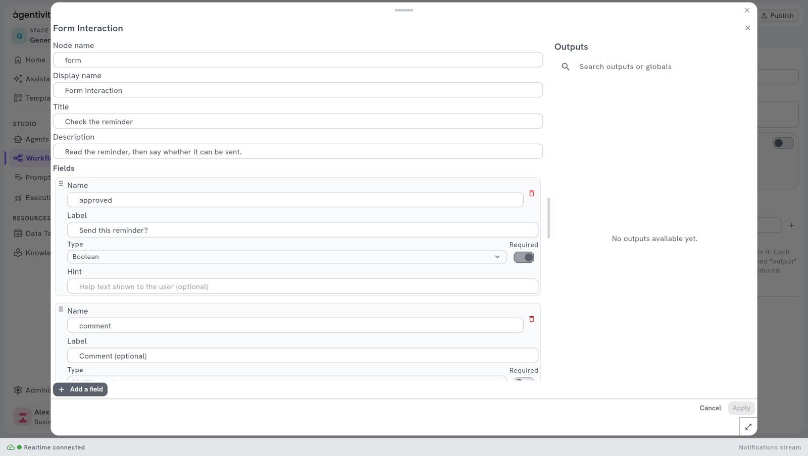

<!-- GENERATED from agentivity_docs/en/workflows/ask-with-a-form.md. Do not edit here: edit the source and publish again. -->

A question with one free answer is sometimes not enough. A form asks for several values at once, each in its own field. The workflow stops, a person fills in the form, and the workflow continues with the values.

For one question and one answer, use the simpler step: [Ask a person to approve or answer](/docs/workflows/ask-a-person-to-decide/).

## What you need

- A workflow open in its editor. See [Create a workflow](/docs/workflows/create-a-workflow/).

## Add the step and its channel

1. In the **Nodes catalog**, open **Interactions** and drag **Form Interaction** onto the canvas.
2. Open **AI** > **Interactions** and drag **Forms Channel** onto the canvas, below the step. It appears as a circle.
3. Drag from the diamond of **Forms Channel** to the diamond under **Form Interaction**.
4. Link **Form Interaction** to the step that must run after the form.

## Describe the form

1. Right-click **Form Interaction** and select **Edit**.
2. In **Title**, type the title of the form.
3. In **Description**, say what the person must do.
4. Under **Fields**, describe the fields: one block for each field. See the next section.
5. Select **Apply**, then **Publish**.



## Describe the fields

Under **Fields**, each field is a block with its **Name**, its **Label**, its **Type** (chosen in a list), the switch **Required** and a **Hint**. Select **Add a field** to add one, and the bin at the top right of a block to remove it.

Behind the window, the fields are saved as a list in a format named JSON, which is also the form of an API call. This example shows the same three fields as such a list:

```json
[
  { "name": "customer", "label": "Customer", "type": "Text", "required": true },
  { "name": "amount", "label": "Amount due", "type": "Number", "required": true },
  { "name": "send", "label": "Send the reminder", "type": "Boolean" }
]
```

What each part means:

| Part | What it is |
|---|---|
| `name` (**Name**) | The name of the field for the workflow. Lower case, no space. The next steps use this name. |
| `label` (**Label**) | What the person reads next to the field. |
| `type` (**Type**) | The kind of value. See the list below. |
| `required` (**Required**) | `true` if the person must fill in the field. A field with no `required` is required. |
| `hint` (**Hint**) | A short help text. It is optional. |
| `defaultValue` | A value already filled in, which the person can keep or change. It is optional. |
| `options` | For a field of type `Choice`: the list of choices, each between quotation marks. |

The types:

| Type | The person enters |
|---|---|
| `Text` | One line of text. |
| `MultilineText` | Several lines of text. |
| `Number` | A number. |
| `Boolean` | Yes or no. |
| `Choice` | One of the choices you listed in `options`. |
| `Date` | A date. |
| `File` | A file. |

In an API call, write the types exactly as shown, with their capital letters.

## Use the values in the next steps

After the person submits the form, the step produces:

| Output | What it holds |
|---|---|
| One output per field, with the name of the field | The value the person entered. In the example: `customer`, `amount` and `send`. |
| `response_data` | All the values together. |
| `outcome` | The result of the form, for example `Submitted`. |
| `responded_by` | Who answered. |

For example, link an **If** step after the form, and test the output `send`. See [Add a condition to a workflow](/docs/workflows/add-a-condition/).

## How to know it worked

1. Run the workflow. See [Run a workflow and follow each step](/docs/workflows/run-a-workflow/).
2. The workflow stops at the form. In the section **Executions**, the execution has the label **ACTION REQUIRED**.
3. In the **Execution** view of the workflow, open the tab **Forms** in the panel on the right, fill in the form and submit it.
4. The execution continues and reaches the state completed.

## If it does not work

- **The step fails, or the form has no field.** Check that each field has a **Name** and a **Type**. In an API call, check the commas, the quotation marks and the curly braces of the list, and the spelling of each `type`.
- **The workflow does not stop.** Check that **Forms Channel** is plugged into the diamond of the step.
- **A field cannot be left empty.** A field is required unless you write `"required": false`.

## Good to know

- An agent can ask for a form too, by itself, when it has a **Forms Channel**. See [Let an agent ask a person before it decides](/docs/agents/let-an-agent-ask-a-person/).
- In the Community edition there is no login, so Agentivity does not check who fills in the form.

## Next step

[Add a condition to a workflow](/docs/workflows/add-a-condition/).
