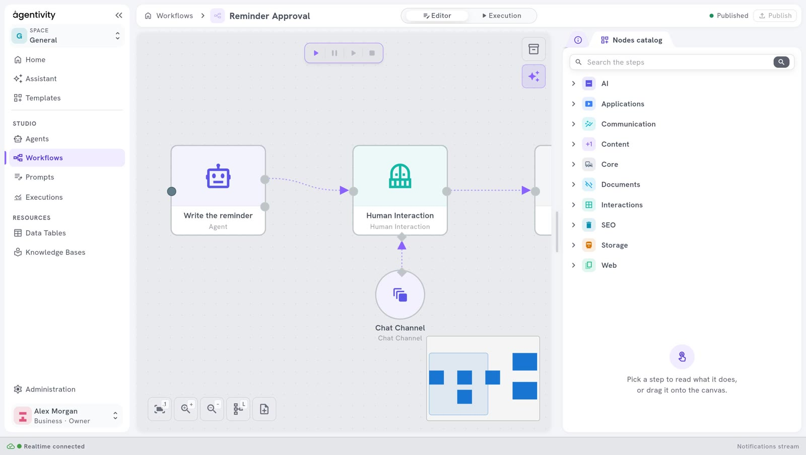

<!-- GENERATED from agentivity_docs/en/workflows/create-a-workflow.md. Do not edit here: edit the source and publish again. -->

A workflow is a set of steps that you draw in advance. The steps run in the order you drew, the same way every time. This page shows the gestures you use for every workflow. The pages that follow add the steps one kind at a time.

<video controls muted playsinline preload="metadata" src="/docs-media/en/workflows/images/create-a-workflow.mp4" aria-label="A recording of the Studio: a workflow named Reminder Approval is created, three nodes are dragged from the Node Catalog onto the canvas, they are linked, and the workflow is published"></video>

The recording is played faster than real use.

## What you need

- Agentivity running, with the Studio open. See [Install Agentivity with Docker](/docs/getting-started/install-community/).

## Create the workflow

1. On the home page, select **Create new workflow**. You can also open **Studio** > **Workflows** and select **New workflow**.
2. In the window **New workflow**, type the **Workflow name**, for example `Reminder Approval`. The name needs at least 3 characters.
3. Select **Create**.

The editor opens with an empty canvas.

## Describe it

In the panel **Info**, on the right, fill in **Role**: one or two sentences on what this workflow handles.

## Find a step in the Node Catalog

A step of a workflow is called a node. The **Node Catalog** holds all the nodes you can use.

1. In the panel on the right, select the second tab. The **Node Catalog** opens.
2. Open a category, or type a name in the search field and press Enter.

| Category | What you find there |
|---|---|
| **AI** | Agents, AI models, Knowledge Bases, Vector Stores, sessions, tools for agents. |
| **Applications** | Steps that work with other applications. |
| **Communication** | Steps that send messages. |
| **Content** | Steps that build and change content. |
| **Core** | Conditions, loops, variables, data tables, code, display. |
| **Interactions** | Steps that ask a person something. |
| **SEO** | Steps for search engine work. |
| **Storage** | Steps that read and write stored values. |
| **Web** | Steps that search the web and read web pages. |

Select a node in the catalogue to read what it does, at the bottom of the panel.

## Add steps and link them

1. Drag a node from the catalogue onto the canvas.
2. Drag a second node next to it.
3. Drag from the dot on the right of the first node to the dot on the left of the second node. An arrow links them: the second step runs after the first.

There are two shapes on the canvas:

- **A box** is a step. It has a dot on the left, where the work comes in, and a dot on the right, where it goes out.
- **A circle** is something a step uses, for example an AI model or a channel to reach a person. It is not a step. You link it to the diamond of the step that uses it.

## Set up a step

1. Right-click the node and select **Edit**. A window opens with the settings of this node.
2. Fill in the fields. A field can hold a **Fixed value**, which you type, or an **Expression**, which is computed when the workflow runs.
3. Select **Apply**.

The panel **Outputs**, on the right of this window, lists what the earlier steps produce. It fills in when the node is linked to the steps before it.

The same menu has **Duplicate**, **Copy** and **Delete**.

## Save

1. Select **Publish**, at the top right.

When you have changes that are not saved, a star follows the name of the workflow at the top, and **Publish** is highlighted. After you publish, the Studio shows "Workflow published".

If you leave the editor with changes that are not saved, the Studio asks what to do: **Keep editing**, **Discard** or **Publish**.

## How to know it worked

- The canvas shows your steps, linked by arrows.
- In **Studio** > **Workflows**, the workflow is in the list.

## The buttons under the canvas

At the bottom left of the canvas, the first button brings the whole drawing into view. The next two zoom in and out.

## Next step

- [Add an AI step to a workflow](/docs/workflows/add-an-ai-step/)
- [Ask a person to approve or answer](/docs/workflows/ask-a-person-to-decide/)
- [Add a condition to a workflow](/docs/workflows/add-a-condition/)
- [Run a workflow and follow each step](/docs/workflows/run-a-workflow/)
