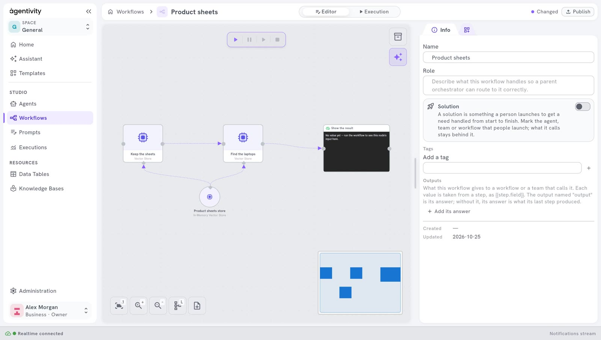

<!-- GENERATED from agentivity_docs/en/workflows/keep-texts-and-find-them-by-meaning.md. Do not edit here: edit the source and publish again. -->

A Vector Store keeps texts and finds again the closest ones to a question, by their meaning. Something puts texts in it: a step of a workflow, or an agent. Something finds them later: another step, or the agent.

It is not the way to give an agent its knowledge. For what an agent must know (documents, pages, feeds), use a Knowledge Base. See [Where each kind of information goes](/docs/introduction/where-does-it-go/).

## What you need

- A workflow open in the editor. See [Create a workflow](/docs/workflows/create-a-workflow/). Or an agent, for the second example.

## Choose a Vector Store

The four stores are under **AI** > **Vector Stores** in the **Nodes catalog**. They are circles: you plug one into the steps and tools that use it.

| Store | Kept for | What it needs |
|---|---|---|
| **In-Memory Vector Store** | The time of one execution. It is free and needs no account. | **Memory key** (`default` at the start): the steps of an execution that use the same key share the same texts. |
| **Qdrant Vector Store** | From one execution to the next. | A Qdrant connection, and a **Collection name** (`agentivity` at the start, created at the first insert). |
| **Pinecone Vector Store** | From one execution to the next. | A Pinecone connection, and a **Namespace** (empty for the default one). |
| **pgvector Vector Store** | From one execution to the next. | A **Connection string** to a PostgreSQL database of your own, with the pgvector extension, and a **Table name** (`agentivity_vectors` at the start, created at the first insert). |

The database of the pgvector store is yours: an outside connection. It has nothing to do with the database of your Agentivity workspace.

Each store has an optional diamond named **Embeddings**. Embeddings turn a text into numbers, so that texts can be compared by meaning. With nothing plugged in, the store uses a small local model, which is free. You can plug **Local Embeddings** or **OpenAI Embeddings** to choose. For a collection that already holds texts, keep the same model: a model of another size is refused with a message.

## Example 1: keep product sheets, then find the closest

A workflow keeps four product sheets, then finds the laptops that fit a question.

1. Drag **In-Memory Vector Store** onto the canvas. Give it the **Memory key** `products`.
2. Drag a **Vector Store** step. Set **Operation** to **Insert Documents**. In **Documents**, give a list in JSON:

   ```json
   [
     { "text": "Acme Book 13: ultralight laptop, 0.9 kg, 899 euros.", "metadata": { "kind": "laptop" } },
     { "text": "Acme Pro 16: workstation laptop, 2.1 kg, 1899 euros.", "metadata": { "kind": "laptop" } },
     { "text": "Acme Dock: docking station, 149 euros.", "metadata": { "kind": "accessory" } },
     { "text": "Acme Mouse: wireless mouse, 29 euros.", "metadata": { "kind": "accessory" } }
   ]
   ```

3. Drag a second **Vector Store** step and link it after the first. Set **Operation** to **Get Many**, **Query** to `What is the lightest laptop?`, **Limit** to `2`, and **Metadata filter** to `{ "kind": "laptop" }`.
4. Plug the In-Memory Vector Store into the diamond **Vector Store** of **both** steps.
5. Run the workflow.



What we saw: the first step gave `inserted` 4. The second step gave `count` 2 and `documents`: the Acme Book 13 first, with a score, then the Acme Pro 16. The accessories were left aside by the filter.

### The three operations

| Operation | What you give | What you get |
|---|---|---|
| **Insert Documents** | **Documents**: one text, a list of texts, or a list of blocks with `text`, and if you want `metadata` and `id`. A text inserted again with the same `id` replaces the old one. **Metadata** says something about all the texts. **Split long texts** cuts a long text into passages. **Clear the collection first** empties the store before inserting. | `inserted` (how many) and `ids`. |
| **Get Many** | **Query**: the question. **Limit**: the most texts to give, 4 at the start. **Metadata filter**: keeps only the texts whose metadata has every value of this JSON object. | `documents`, the closest first, each with `id`, `text`, `score` and `metadata`, and `count`. |
| **Delete Documents** | **Ids**: a list in JSON, or separated by commas. | `deleted` (how many). |

## Example 2: an agent that searches the store

An agent can search a Vector Store itself, with the **AI Agent Vector Store Tool**.

1. In the workflow of example 1, keep the step **Insert Documents**, and add an **AI Agent** step after it, with its model.
2. Drag **AI Agent Vector Store Tool** onto the canvas, and plug it into the diamond **AI Agent Tools** of the agent.
3. Plug the same In-Memory Vector Store into the diamond **Vector Store** of the tool.
4. Give the tool a **Name**, for example `Products`, and a **Description** that tells the agent what the texts are: "The product sheets of Acme: laptops and accessories."

The tool gives the agent a search named after it: `search_products`. The agent uses it when it needs to. The developer ran this with a model: asked "the lightest laptop under 1000 euros", the agent searched `search_products` and answered with the Acme Book 13, 0.9 kg, 899 euros. We did not run the agent ourselves.

## Example 3: a notebook the agent fills itself

By default, the tool only searches. To let the agent keep texts itself, turn on **Allow storing**. The agent then also has a tool named `store_` and the name, for example `store_customer_notes`, and puts in the store what it wants: a note, what it learned.

1. Give the tool the **Name** `Customer notes`, and the **Description** "Notes on our customers."
2. Turn on **Allow storing**.
3. Use a store that keeps texts (Qdrant, Pinecone or pgvector) if the notes must last after the execution. With **In-Memory**, they last one execution.

The developer ran this with a model: the agent stored "Mrs Martin prefers to be called in the morning, before 10", found it again, and answered "before 10". We did not run it ourselves.

### The settings of the tool

| Setting | What it is |
|---|---|
| **Name** | Names the tools of the agent. "Customer notes" gives `search_customer_notes`, and `store_customer_notes` if storing is allowed. |
| **Description** | What the texts are, told to the agent so it knows when to search. |
| **Limit** | The most texts one search gives, 4 at the start. |
| **Allow storing** | Also lets the agent keep texts. Off at the start. |

## How to know it worked

- In the workflow, the step **Insert Documents** gives a number in `inserted`, and the step **Get Many** gives `count` and `documents`. Read them in the panel **Outputs** or in the **Inspector**.
- For an agent, the **Inspector** shows the search that the agent made.

## If it does not work

- **`count` is 0.** The two steps do not use the same store, or the same **Memory key**. Plug the same circle into both. Or the **Metadata filter** keeps nothing: check the spelling of the values.
- **The agent never searches.** Say in its instructions what the texts are and when to look in them. Check the **Description** of the tool.
- **The texts are gone after the execution.** The store is **In-Memory**. Use Qdrant, Pinecone or pgvector.
- **A message about the size of the model.** The collection was filled with another embeddings model. Plug the same one, or use another collection.

## Good to know

- **Do not use a Vector Store as a Knowledge Base.** An agent that must know your policies, guides or pages needs a Knowledge Base: it reads the source and stays up to date. See [What a Knowledge Base is for](/docs/knowledge-bases/what-a-knowledge-base-is/).
- What an agent finds in a store is sent to the AI model, like the rest of the conversation.

## Next step

[Give an agent knowledge and a memory](/docs/agents/give-memory-and-knowledge/).
