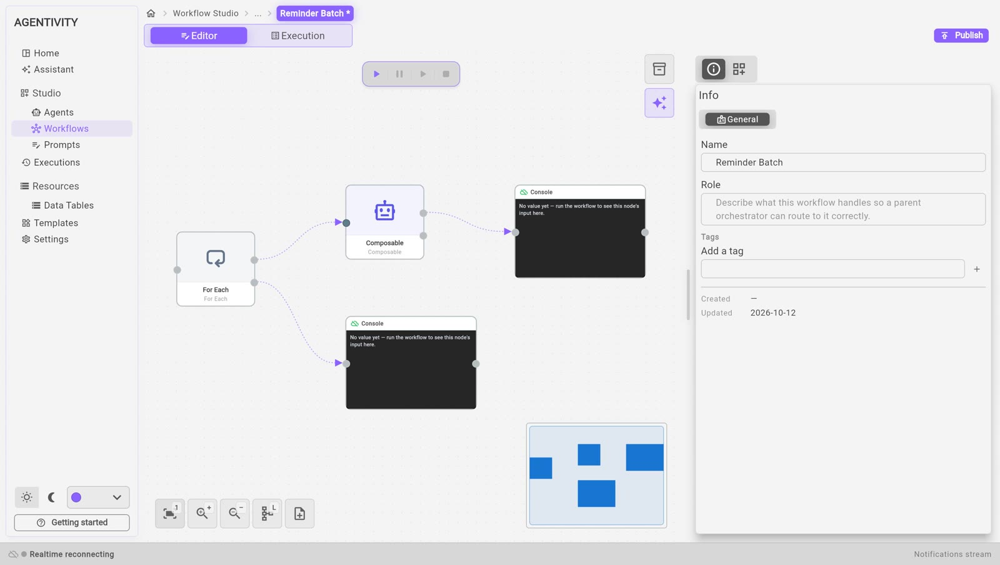
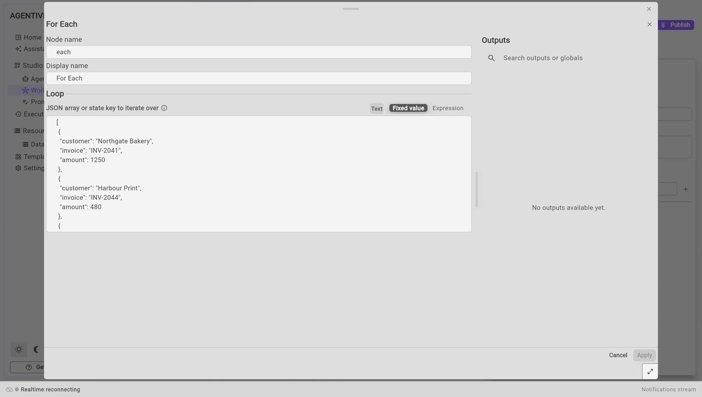

<!-- GENERATED from agentivity_docs/en/workflows/repeat-steps.md. Do not edit here: edit the source and publish again. -->

You have three unpaid invoices, and you want one reminder for each. You do not draw the same steps three times: a **For Each** step runs them once per item of a list.

## What you need

- A workflow open in the editor. See [Create a workflow](/docs/workflows/create-a-workflow/).
- A list of items. In the example, three invoices.

## How a loop is drawn



A **For Each** step has two exits on its right side:

| Exit | Where it is | What starts from it |
|---|---|---|
| **Loop** | The upper dot | The steps to repeat. They run once per item. |
| **Out** | The lower dot | What comes next. It runs once, when every item is done. |

## Add the loop

1. Open the **Node Catalog** and search for `For Each`. It is in **Core** > **Control Flow**.
2. Drag **For Each** onto the canvas, and link the step before it to its left dot.
3. Right-click the step and select **Edit**.
4. In **Node name**, type a short name, for example `each`. You use this name to read the current item.
5. In the field of the group **Loop**, enter the list. See the next section.
6. Select **Apply**.
7. Link the upper dot to the first step to repeat.
8. Link the lower dot to the step that comes after the loop.
9. Select **Publish**.

## Write the list



The list is written in a format named JSON: square brackets around the list, a comma between the items. An item can be a plain text, or a block between curly braces with named fields. Copy this example and change the values:

```json
[
  { "customer": "Northgate Bakery", "invoice": "INV-2041", "amount": 1250 },
  { "customer": "Harbour Print", "invoice": "INV-2044", "amount": 480 },
  { "customer": "Elm Street Garage", "invoice": "INV-2050", "amount": 2300 }
]
```

The list can also come from an earlier step. Select **Expression** above the field and write the reference of the output that holds the list.

## Read the current item

Inside the loop, the step **For Each** gives these outputs. Their names start with the node name of the step: here, `each`.

| Output | What it holds |
|---|---|
| `each.current_item` | The item of this turn. |
| `each.current_item.customer` | One field of the item. Replace `customer` with the name of your field. |
| `each.current_index` | The position of the item. It starts at 0: the first item is 0, the second is 1. |
| `each.is_first`, `each.is_last` | True on the first item, true on the last one. |
| `each.total_count` | The number of items in the list. |

You use one in a field by writing its reference, between two pairs of curly braces. The panel **Outputs** of each step in the loop lists them.

In the example, the task given to the agent is written with three references: the customer, the invoice number and the amount of the current item. See the picture in [Use an agent or a team as a step](/docs/workflows/use-an-agent-or-a-team/).

## After the loop

The steps linked to the lower dot run when the list is finished. One more output is useful there:

| Output | What it holds |
|---|---|
| `each.count` | The number of items done. |

## How to know it worked

1. Put a **Console** step in the loop, with the reference of one field of the current item as its value.
2. Put another **Console** step after the loop, with `each.count`.
3. Run the workflow.
4. The run ends as completed, and the second **Console** shows the number of items.

We ran this with the list above. The steps in the loop received each customer in turn, and the step after the loop showed 3.

## Limits to know today

- **No question to a person inside a loop.** A loop runs all its items in one go and cannot wait. If a step in the loop asks a person, the run fails, and the message says so. Ask before the loop or after it.
- **The Studio shows the last item only.** After a run, each step of the loop shows what it received and produced for the last item. To keep a trace of every item, write each result in a Data Table from inside the loop. See [Use a table in a workflow](/docs/data-tables/use-a-table-in-a-workflow/).
- **The loop does not collect what its steps produce.** The output `results` holds the items of the list, not the answers of the steps. In our test, it could not be written in a text field.
- **One failure fails the run.** If a step of the loop fails on one item, the whole run fails.
- **An empty list is not an error.** The steps of the loop are skipped, and the workflow continues from the lower dot.
- **An AI step in a loop costs once per item.** A list of one hundred items uses the AI model at least one hundred times. Try with two or three items first.

## If it does not work

- **The loop runs once, with the whole list as one item.** The list is not valid JSON. Check the square brackets, the commas and the quotation marks.
- **A field of the item is empty.** Check the spelling of the field, and the node name of the **For Each** step in the reference.
- **The run fails with a message about a loop that cannot wait.** A step in the loop asks a person. Move it out of the loop.

## Reference

[For Each in the node reference](/docs/reference/nodes-core/).

## Next step

[Run a workflow and follow each step](/docs/workflows/run-a-workflow/).
