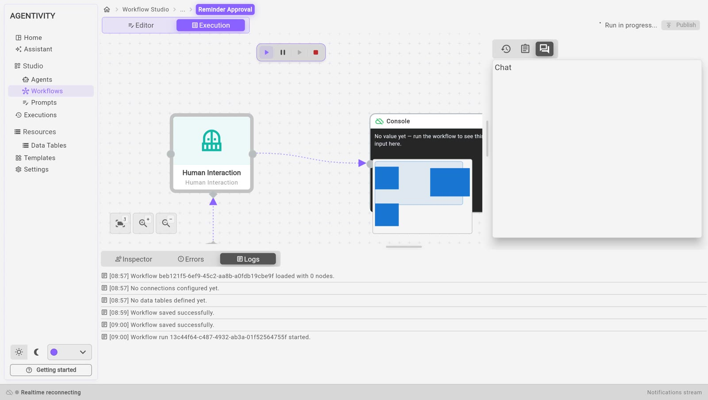

<!-- GENERATED from agentivity_docs/en/workflows/run-a-workflow.md. Do not edit here: edit the source and publish again. -->

An execution is one time that a workflow works, from its first step to its last. This page shows how to start an execution from the Studio and how to see what happened.

## What you need

- A workflow with at least one step, published. See [Create a workflow](/docs/workflows/create-a-workflow/).
- If the workflow has an AI step: a model connection that works. See [Connect an AI model](/docs/guides/connect-a-model/).

## Start an execution

1. Open **Studio** > **Workflows** and open the workflow.
2. In the switch at the top, select **Execution**. If the workflow has changes that are not published, the Studio first says **Publish before leaving the editor**: select **Publish**. When the workflow can run, you read **Ready to run** at the top right.
3. In the bar above the canvas, select the first button, **Run**.

The same bar has **Pause**, **Resume** and **Stop run**. **Pause** shows while the execution runs, and **Resume** only once you paused it: it undoes your pause. An execution that waits for a person is not paused: you answer it, there is no **Resume** to select.

## Follow the execution

The state of the execution is shown at the top right, for example **Run in progress: write**. When a step asks a person something, the state is **Waiting for input**, followed by the name of the step, for example **Waiting for input: ask**. See [Ask a person to approve or answer](/docs/workflows/ask-a-person-to-decide/).

On the canvas, a colour says the state of each step: at work, waiting, done or failed. It is the same whatever the group of the step, and the backgrounds of the groups stay, so you see which part of the workflow the execution has reached.

Below the canvas, three tabs show what happens:

| Tab | What it shows |
|---|---|
| **Inspector** | The steps of the execution. Select a step to see its inputs, its outputs and its logs. |
| **Errors** | What went wrong. When all is well, it says "No runtime errors detected." |
| **Logs** | One line for each event, with the time: the execution started, the execution waits for a person, and so on. |

On the right, a panel has three tabs: the earlier executions of this workflow, the forms that wait for an answer, and the **Chat** of the execution.

## See a value on the canvas

To see a value without opening the **Inspector**, add a **Console** node at the end of the workflow. It is in the **Nodes catalog**, under **Core** > **Display**. Before an execution, it says "No value yet". After an execution, it shows the value it received.

## Find an execution again

1. In the menu on the left, select **Executions**. The page **Executions** lists the latest executions of your whole workspace: workflows, agents and teams.
2. Use the list **All states** to keep only the executions in one state.
3. On the line of an execution:
   - **Open workflow** opens the workflow in its editor;
   - **Details** shows the state of the execution and the state of each step.

An execution that waits for a person has the label **ACTION REQUIRED**.

To stop or delete several executions at once, tick them, choose the action in the list **Batch action**, then select **Apply**.

## How to know it worked

- In the tab **Logs**, you read that the execution started.
- In **Executions**, the execution is in the list. In **Details**, every step that ran is completed.

## If it does not work

- **A step failed.** Open the tab **Errors** to read the message. Then select the step in the **Inspector** and compare its inputs with what you expected.
- **The execution stays in Waiting for input.** A person must answer. Open the **Chat** of the execution.

## Good to know

Executions start when a person starts them, or on a schedule on the hosted plans.

## Next step

[Add a condition to a workflow](/docs/workflows/add-a-condition/), [add an AI step](/docs/workflows/add-an-ai-step/), or [repeat steps for each item of a list](/docs/workflows/repeat-steps/).
