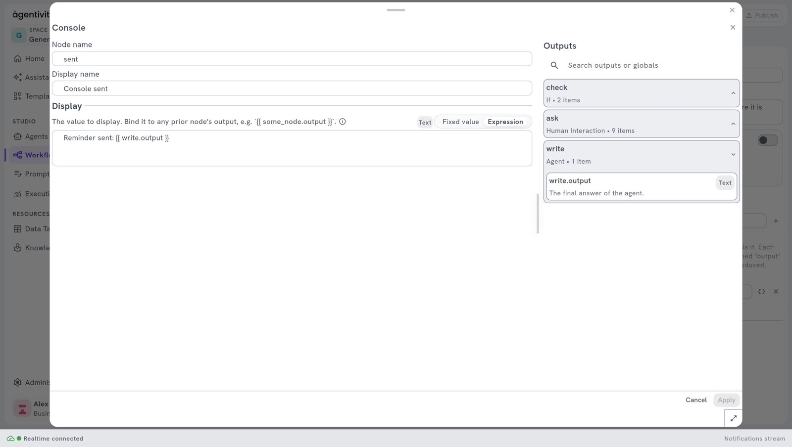

<!-- GENERATED from agentivity_docs/en/workflows/use-an-agent-or-a-team.md. Do not edit here: edit the source and publish again. -->

You have built an agent or a team, and it works. To use it inside a workflow, you do not rebuild it: you add one step that calls it. The example calls the agent `Reminder Writer` from a workflow.

## Three steps, one for each kind

| Step | What it calls | Where it is in the **Node Catalog** |
|---|---|---|
| **Agent** | An agent of your library. | **AI** > **Agents** |
| **Team** | A team of your library. | **AI** > **Agents** |
| **Workflow** | Another workflow of your library. | **Core** > **Workflow** |

The three work the same way. You choose what the step calls, you write the message it sends, and the next steps use the answer.

## AI Agent step, or Agent step

| | **AI Agent** step | **Agent** step |
|---|---|---|
| Where the agent is defined | In the workflow. You write its instructions and plug its model there. | In **Studio** > **Agents**. The workflow only calls it. |
| Use it when | The agent serves this workflow only. | The agent exists already, or serves several workflows. |

See [Add an AI step to a workflow](/docs/workflows/add-an-ai-step/) for the first one. This page is about the steps that call your library.

## What you need

- A workflow open in the editor. See [Create a workflow](/docs/workflows/create-a-workflow/).
- An agent, a team or a workflow that works on its own. Try it first: see [Run an agent](/docs/agents/run-an-agent/), [Run a team](/docs/teams/run-a-team/) or [Run a workflow](/docs/workflows/run-a-workflow/).

## Add the step

1. Open the **Node Catalog** and search for `Agent`, `Team` or `Workflow`.
2. Drag the step onto the canvas.
3. Link the step before it to its left dot.
4. Right-click the step and select **Edit**.

## Choose what it calls

1. Select **Choose an agent…** (or **Choose a team…**, **Choose a workflow…**).
2. A window opens on your library, with its folders and a search field. It shows only what this step can call: the agents for **Agent**, the teams for **Team**, the workflows for **Workflow**.
3. Select the one you want. Its name now shows in the window of the step.

The step keeps the identifier of what you chose, not its name. You can rename the agent later: the step still calls it.

## Write the message

In **Message**, write what to ask, as you would type it in the chat of the agent. For example:

```text
Write a payment reminder for Northgate Bakery, invoice INV-2041, 1,250 euros.
```

To put a value from an earlier step in the message, write the reference of its output: the node name of the step, a dot, the name of the output, between two pairs of curly braces. The panel **Outputs**, on the right, lists the names you can use.

The step sends only this message. Put in it everything the agent, the team or the workflow needs to know.

Then select **Apply**, and **Publish**.

## Use the answer

What you call is a closed box. The step gets its answer and, when it has some, its named outputs. Nothing else of what happens inside is visible to the step: not the steps of a workflow you called, not what the members of a team said to each other.

| Output | What it holds |
|---|---|
| `output` | The answer. |
| Named outputs | The values that what you call gives next to its answer, each under its own name. |

Use a value in a later step with its reference: the node name of the step, a dot, then the name of the output, between two pairs of curly braces. For a step named `call`, the reference `call.output` is the answer, and `call.city` is a named output `city`.

The panel **Outputs**, in the window of a later step, lists the names you can use. It includes the named outputs of what the step calls, with their type and their description.



| You call | Its answer, `output` | Its named outputs |
|---|---|---|
| An agent | Its final answer. | The fields of the format of its answer, when it has one. See [Write the role and the instructions of an agent](/docs/agents/write-the-instructions/). |
| A team | The answer of the team: see below. | Those of the member who concludes: see below. |
| A workflow | Its output named `output`. | The outputs it declares. See [Create a workflow](/docs/workflows/create-a-workflow/). |

### What a team gives

The answer of a team depends on how it works.

| How the team works | Its answer |
|---|---|
| **Manager-led** | The final answer of the manager. If the manager ended without one, the last answer given. |
| **Handoff** | The answer of the last member who answered: the one who handled the request. A member that only passed the request on is not the answer. |
| **Sequential** | The answer of the last member. |
| **Concurrent** | The answer of every member, each one after the name of the member (`Flights:`, then its answer, then `Hotels:`, and so on), in the order of the team. |
| **Group chat** | The last answer of the discussion. |

This is also the answer that the execution of the team shows, and the one that a team gives when it is a member of another team.

A team gives the named outputs of the member whose answer is its answer: the one who concludes. In a **Manager-led** team, it is the manager. A **Concurrent** team gives none, because nobody concludes there. See [Use a team or a workflow as a member](/docs/teams/put-a-team-in-a-team/).

### What a workflow gives back

A called workflow gives only what it says it gives: its answer, and the outputs it declares. See "Say what the workflow gives" in [Create a workflow](/docs/workflows/create-a-workflow/).

- **Its answer** is its output named `output`. A workflow that declares none answers with the text of its last step that produced one: the engine looks, from the last step that ran back to the first, for an output named `output`, `result`, `response` or `content`.
- **The outputs of its steps are not given.** A value that belongs to a step of the called workflow, such as `line.value`, cannot be read from the workflow that calls it. If you need that value, declare it as an output of the called workflow.

What we saw: a called workflow that declared `output` and `city` gave both, and the calling step read `call.city`. The value of one of its inner steps, `call.a.value`, was empty. A called workflow that declared nothing and ended on a **Console** step gave an empty answer, because the output of a **Console** is named `value`.

### When what you call fails

A failure inside what you call fails the step that called it: the agent, the team or the workflow fails, then the step that called it, and so on as far as the whole execution. The message says what failed, and why. For example: `The workflow 'Reminder Approval' failed: …`. When the failure is deep inside, the message names each level.

The step has two exits on its right side: **Out**, where the workflow goes on, and **Error**.

- If **Error** is linked, the workflow goes on from there, and the output `error` holds the message. Link it to a step that handles the failure.
- If **Error** is not linked, the execution fails, and the whole execution with it. No later step runs.

A team whose model does not answer, refuses, or cannot choose which member answers first fails too: the message says that the team could not choose which member answers first. It no longer goes on with a member chosen by default.

## When what you call waits

What you call may stop to wait: an agent that asks a person a question, a workflow with an approval step. Your workflow then waits with it, and goes on when what you called has finished.

What we saw with a workflow that asks a person: the calling step showed the state "waiting for input", and the execution stayed in that state. We did not see the question in the list of pending questions of the calling execution (`/executions/{executionId}/hil/pending`), so we could not answer it through the API. We did not try to answer it in the Studio. Until this is checked, test a call that waits in the Studio before you rely on it.

This is not possible inside a loop. If a step of a **For Each** loop calls something that waits, the execution fails, and the message says that a loop cannot wait. See [Repeat steps for each item of a list](/docs/workflows/repeat-steps/).

## What the step refuses

- **Something of another kind.** Each step calls only its own kind. Given a team, the step **Agent** stops the execution, with a message that names the chosen item and says that it is a team. Use the step **Team** for a team.
- **Nothing chosen.** A step with nothing chosen stops the execution, with a message that says no agent (or team, or workflow) is chosen.

## If Agent and Team are not in the catalogue

The library of agents and teams can be turned off on a server, with the setting `Features__AgenticLibrary__Enabled`. It is on by default. When it is off, the steps **Agent** and **Team** are not offered, and only **Workflow** is. The **AI Agent** step keeps working.

## How to know it worked

Run the workflow. In the tab **Execution**, the step turns to completed, and the next step receives the answer. See [Run a workflow and follow each step](/docs/workflows/run-a-workflow/).

## If it does not work

- **The execution fails at this step, and the message says what the chosen item is.** The step and what it calls are not of the same kind. Use the step that matches.
- **The answer is empty, and the step called a workflow.** The called workflow declares no output named `output`, and none of its steps produced an output named `output`, `result`, `response` or `content`. Declare its answer. See "What a workflow gives back".
- **A value from inside the called workflow is empty.** A called workflow no longer gives the outputs of its own steps. Declare that value as an output of the called workflow, then read it by the name of the step and the name of the output, between two pairs of curly braces.
- **The whole execution fails at this step.** What you called failed, and the exit **Error** of the step is not linked. The message says what failed, and why. Fix it, or link a step to **Error** to go on.
- **A named output of an agent is empty.** The agent has no format for its answer, or its answer does not hold that field. See [Write the role and the instructions of an agent](/docs/agents/write-the-instructions/).
- **The agent answers beside the point.** The step sends only the message. Put the facts the agent needs in it.

## Good to know

- **Each call costs.** An agent or a team uses the AI model each time the step runs. A team uses it many times.
- **A workflow is called by its identifier.** Renaming the called workflow does not break the step.

## Reference

[Agent and Team](/docs/reference/nodes-ai-agents-and-models/), and [Workflow](/docs/reference/nodes-core/), in the node reference.

## Next step

[Repeat steps for each item of a list](/docs/workflows/repeat-steps/), to call the agent once per customer.
