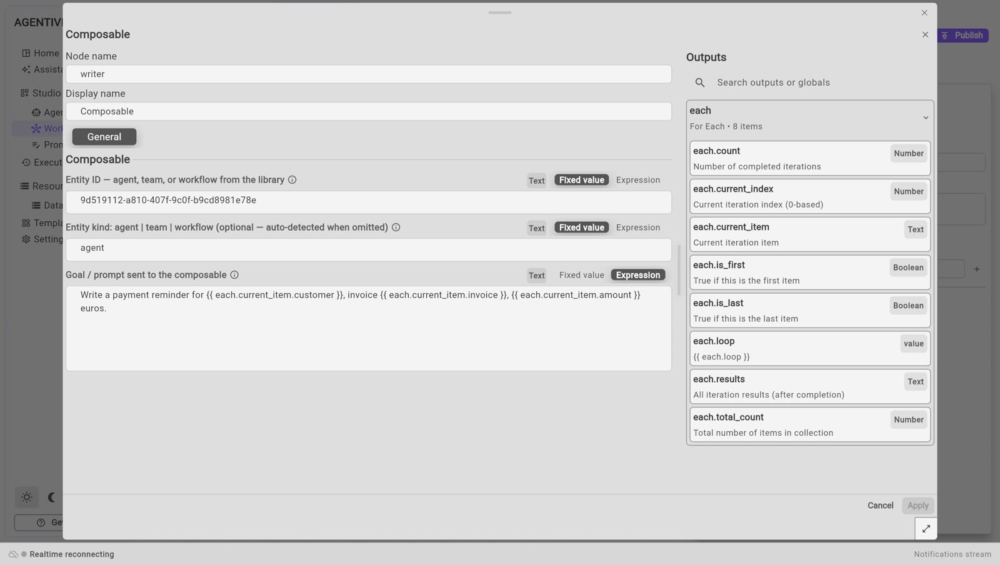

<!-- GENERATED from agentivity_docs/en/workflows/use-an-agent-or-a-team.md. Do not edit here: edit the source and publish again. -->

You have built an agent or a team, and it works. To use it inside a workflow, you do not rebuild it: you add one step that calls it. The example calls the agent `Reminder Writer` from a workflow.

## AI Agent step, or Composable step

| | **AI Agent** step | **Composable** step |
|---|---|---|
| Where the agent is defined | In the workflow. You write its instructions and plug its model there. | In **Studio** > **Agents**. The workflow only calls it. |
| Use it when | The agent serves this workflow only. | The agent or the team exists already, or serves several workflows. |
| What it can call | One agent. | An agent, a team or another workflow. |

See [Add an AI step to a workflow](/docs/workflows/add-an-ai-step/) for the first one. This page is about the second.

## What you need

- A workflow open in the editor. See [Create a workflow](/docs/workflows/create-a-workflow/).
- An agent or a team that works on its own. Try it first: see [Run an agent](/docs/agents/run-an-agent/) or [Run a team](/docs/teams/run-a-team/).

## Find the ID of the agent or the team

The step asks for the ID of what it calls. An ID is a long code of letters, digits and dashes. Today the Studio does not show it, so you read it from the server:

1. Open a new tab in your browser.
2. Go to the address of your Studio, followed by `/api/v1/entities`. With the default install: `http://localhost:5005/api/v1/entities`.
3. The page lists every agent, team and workflow. Find the one you want by its `displayName`, and copy the value of `id` next to it.

## Add the step

1. Open the **Node Catalog** and search for `Composable`. It is in **AI** > **Agents**.
2. Drag **Composable** onto the canvas.
3. Link the step before it to its left dot.
4. Right-click the step and select **Edit**.

5. Fill in the three fields:

| Field | What to enter |
|---|---|
| **Entity ID** | The ID you copied. |
| **Entity kind** | `agent`, `team` or `workflow`. You can leave it empty: Agentivity finds the kind from the ID. |
| **Goal / prompt sent to the composable** | The task, as you would type it in the chat of the agent. |

6. To put a value from an earlier step in the task, select **Expression** above the field and write the reference of the output. The panel **Outputs**, on the right, lists the names you can use.
7. Select **Apply**, then **Publish**.

## Use the answer

The step has one output, named `output`: the final answer of the agent or the team. Use it in the next step with its reference: the name of the step, a dot, then `output`.

The step has two exits on its right side: **Out**, and **Error**.

## How to know it worked

Run the workflow. In the tab **Execution**, the step turns to completed, and the next step receives the answer. See [Run a workflow and follow each step](/docs/workflows/run-a-workflow/).

This page was checked in the Studio and through runs that call a workflow. A run that calls an agent or a team could not be done on the test machine.

## Limits to know today

- **A wrong ID stops the run.** The run fails with a message that says the ID could not be found as an agent, a team or a workflow. In our test, the exit **Error** was not followed.
- **A workflow called as a step cannot ask a person.** In our test, the question was skipped without a message, and the step ended at once. Keep the questions in the main workflow. This was tested with a workflow as the target, not with an agent or a team.
- **A workflow called as a step gives no `output`.** In our test, `output` was empty when the target was a workflow.
- **Each call costs.** The agent or the team uses the AI model each time the step runs. A team uses it many times.

## Two other steps do the same

The catalogue holds two more steps next to **Composable**. They work the same way.

| Step | What it calls | Name of the answer |
|---|---|---|
| **Team** | A team only. | `output` |
| **Library Agent** | An agent or a team. | `response` |

## Reference

[Composable, Team and Library Agent in the node reference](/docs/reference/nodes-ai-agents-and-models/).

## If it does not work

- **The run fails at this step.** Check the ID: copy it again, with no space before or after.
- **The answer is empty.** Check that the next step uses the right name: `output` for **Composable** and **Team**, `response` for **Library Agent**.
- **The agent answers beside the point.** The step sends only the text of the goal. Put in it everything the agent needs to know.

## Next step

[Repeat steps for each item of a list](/docs/workflows/repeat-steps/), to call the agent once per customer.
