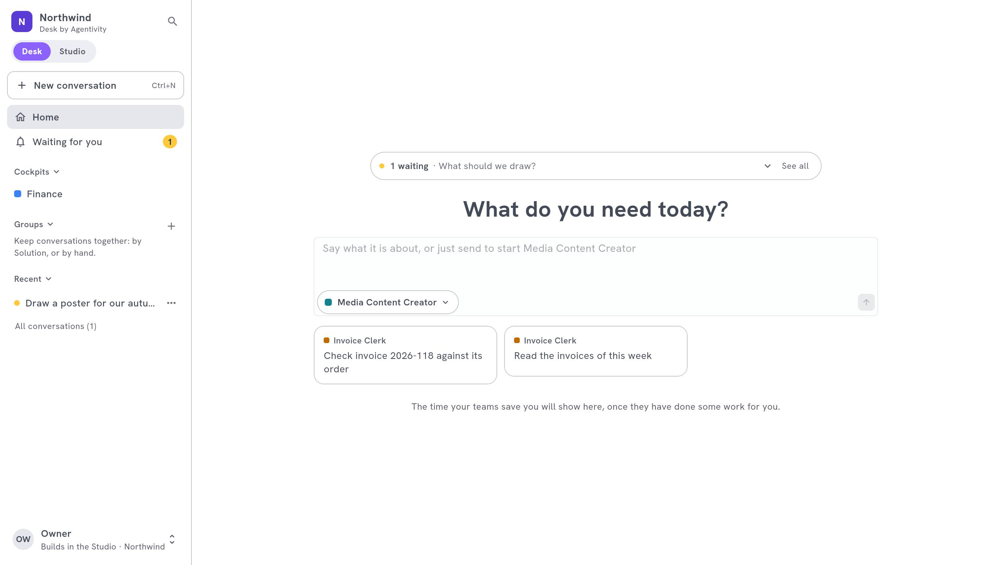

<!-- GENERATED from agentivity_docs/fr/desk/agentivity-desk.md. Do not edit here: edit the source and publish again. -->

Vous construisez des agents, des équipes et des workflows dans le Studio. Les personnes qui ont besoin de leur travail, à la Finance, aux Ventes ou au Support, ne veulent rien construire : elles veulent demander, répondre quand on les sollicite, et retrouver le résultat. **Desk by Agentivity** est leur endroit.

## Pourquoi un Desk

- **Le Studio est pour ceux qui construisent.** Il montre des prompts, des nœuds, des identifiants et des réglages. La plupart des collègues n'ont pas à voir cela.
- **Le Desk montre seulement ce qui est fait pour eux.** Les Solutions que vous publiez, les questions qu'on leur pose, leurs conversations, et le cockpit de leur département.
- **Une personne sur une place Desk ne peut rien casser.** Elle lance des Solutions et répond. Elle ne change ni un agent, ni un workflow, ni un réglage.

## Ce que fait une personne dans le Desk

| Elle | Comment |
|---|---|
| **Demande du travail** | Elle décrit ce qu'il lui faut dans le champ de l'accueil, ou tape **@** pour choisir à qui demander. Voyez [Demander du travail et le suivre](/fr/docs/desk/ask-and-follow-in-the-desk/). |
| **Répond** | Quand une Solution a besoin d'une décision ou d'une validation, la conversation attend sous **Waiting for you**. Voyez [Répondre à ce qui vous attend](/fr/docs/desk/answer-what-waits-for-you/). |
| **Retrouve et range** | Elle cherche, groupe, épingle, archive et partage ses conversations. Voyez [Retrouver et gérer vos conversations](/fr/docs/desk/find-and-manage-conversations/). |
| **Part de son département** | Le cockpit d'un département est sa page de départ. Voyez [Construire un cockpit](/fr/docs/desk/build-a-cockpit/). |

## Ce que fait une personne qui construit pour le Desk

1. [Publier des Solutions dans le Desk](/fr/docs/desk/publish-solutions-to-the-desk/) : choisissez ce que vos collègues peuvent lancer.
2. [Donner au Desk votre marque](/fr/docs/desk/brand-your-desk/) : nom, couleur, logo et mot d'accueil.
3. [Inviter des personnes sur une place Desk](/fr/docs/desk/seats-and-rights-of-the-desk/) : qui peut faire quoi.
4. [Construire un cockpit](/fr/docs/desk/build-a-cockpit/) pour chaque département, avec ses [blocs](/fr/docs/desk/cockpit-blocks/) et sa [mise en page et son style](/fr/docs/desk/lay-out-and-style-a-cockpit/). Quelques [idées par département](/fr/docs/desk/cockpit-examples/).

Pour comprendre comment les pièces s'assemblent, lisez d'abord [Comment fonctionne le Desk](/fr/docs/desk/how-the-desk-works/).

## Ce qu'il vous faut

- Un espace de travail avec un écran de connexion. Le Desk est inclus dans les plans Pro et Business : ni dans Personal, ni dans l'édition Community. Voyez [Les plans et leurs limites](/fr/docs/hosted/plans-and-limits/).
- Au moins une Solution publiée dans le Desk.
- Des personnes invitées sur une place Desk, ou sur une place Studio.

## Ouvrir le Desk

Le Desk est à l'adresse de votre espace de travail. Le Studio est sous `/studio`, à la même adresse. Vous vous connectez une seule fois pour les deux.

- Depuis le Studio, le menu d'une Solution dans **Agents & Workflows** propose **Open in Desk**, et **Open the Desk** en haut du volet **Administration** › **Desk**.
- Depuis le Desk, une personne qui construit ouvre le Studio avec le sélecteur **Desk** | **Studio** en haut de la barre latérale, ou avec **Open the Studio** dans le menu du compte en bas.

## Étape suivante

[Comment fonctionne le Desk](/fr/docs/desk/how-the-desk-works/).
