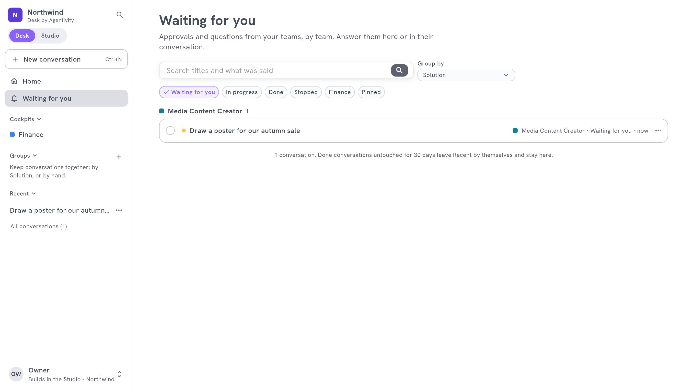

<!-- GENERATED from agentivity_docs/fr/desk/answer-what-waits-for-you.md. Do not edit here: edit the source and publish again. -->

Une Solution a parfois besoin d'une personne : valider un montant, choisir entre deux options, donner un détail manquant. Le Desk met ces demandes au même endroit, **Waiting for you**.

## Où ça s'affiche

- **Sur l'accueil.** Une bande dit combien attendent, montre les premières, et propose **Approve** pour une simple validation. **See all** ouvre la liste.
- **Dans la barre latérale.** **Waiting for you** a un nombre. Il compte les conversations qui attendent votre réponse, pas chaque question. Un point jaune apparaît aussi sur un cockpit quand quelque chose y attend, même replié.
- **Dans un cockpit.** Le bloc **Waiting for you** montre ce qui attend dans ce département. Voyez [Les blocs d'un cockpit](/fr/docs/desk/cockpit-blocks/).

La liste range ce qui attend par Solution. Vous répondez dans la liste, ou dans la conversation.

## Répondre

1. Sélectionnez une demande. Elle dit **Your answer is needed**.
2. Donnez votre réponse : écrivez, choisissez, ou validez.
3. Le travail continue, et la demande quitte la liste.

Une demande à laquelle quelqu'un d'autre a répondu, ou qui n'est plus la vôtre, dit « This question has been answered, or is no longer yours to answer. »

## Ce que compte le nombre

| Compté | Non compté |
|---|---|
| Une conversation qui attend votre réponse | Une question dont le travail est fini, arrêté ou en échec |
| | Une question dans une conversation close |
| | Une question dans une conversation archivée |

Le nombre de la barre latérale et la liste sont toujours d'accord.

## Être prévenu par e-mail

Par défaut, ce qui attend s'affiche dans le Desk avec un point jaune. Pour être aussi prévenu par e-mail :

1. Ouvrez le menu de votre compte, en bas de la barre latérale, et sélectionnez **Notifications**.
2. Activez **E-mail me when a question is asked to me**.

L'e-mail concerne une validation ou une question qu'une équipe vous pose nommément. Il ouvre la demande dans le Desk.

## Arrêter ce qui ne sert plus

Si une demande n'a plus d'intérêt, utilisez **Stop** sur la conversation (dans son menu). Plus rien n'est fait, et plus rien ne vous y attend.

## Comment savoir que ça marche

La demande quitte **Waiting for you**, le nombre baisse, et la conversation continue.

## Si ça ne marche pas

- **Le nombre n'est pas celui que vous attendez.** Une conversation archivée, close ou arrêtée ne compte pas. Voyez ci-dessus.
- **Vous n'avez pas reçu d'e-mail.** **Notifications** est désactivé, ou la question ne vous a pas été posée nommément. Elle reste visible dans le Desk.
- **Vous ne pouvez pas répondre dans une conversation.** Elle appartient à un collègue et est partagée avec vous en lecture. Vous ne répondez qu'à ce qu'on vous demande.

## Étape suivante

[Retrouver et gérer vos conversations](/fr/docs/desk/find-and-manage-conversations/).
