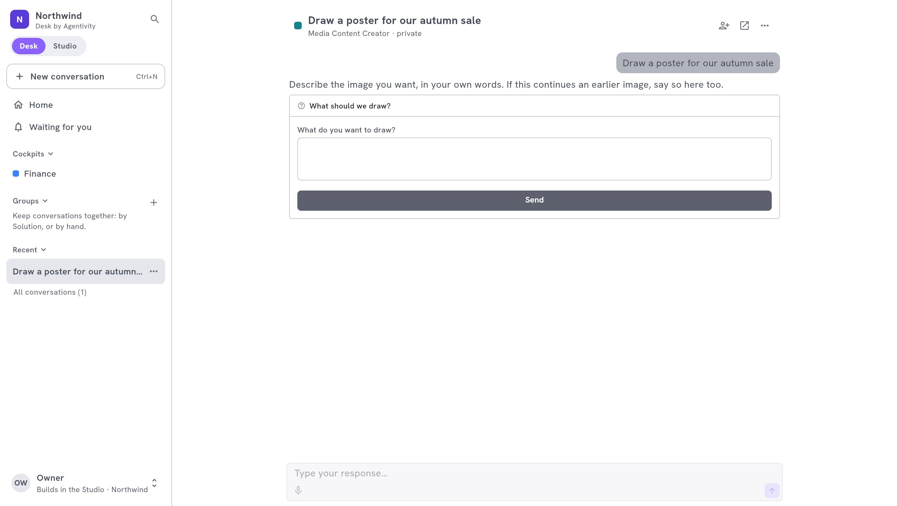

<!-- GENERATED from agentivity_docs/fr/desk/ask-and-follow-in-the-desk.md. Do not edit here: edit the source and publish again. -->

Cette page est pour les personnes qui utilisent le Desk. Elle suit une demande, de la question au résultat.

## Ce qu'il vous faut

- Un compte sur l'espace de travail, sur une place Desk ou une place Studio.
- Au moins une Solution publiée dans le Desk que vous pouvez voir. S'il n'y en a aucune, l'accueil le dit : demandez à la personne qui construit vos équipes.

## L'accueil

| Partie | Ce que c'est |
|---|---|
| **Le champ pour demander** | Au-dessus, le mot d'accueil de votre entreprise. Décrivez ce qu'il vous faut, ou tapez **@** pour choisir à qui demander. Vous pouvez aussi dicter, et ajouter une image quand vous demandez à un agent. |
| **Les suggestions** | Des demandes à lancer d'un clic. |
| **Waiting for you** | Les questions que vos Solutions vous posent, et les décisions qu'elles attendent. |
| **Le temps gagné** | Le temps que vos équipes vous ont fait gagner cette semaine et cette année, les 14 derniers jours, et d'où il vient. Il reste vide tant qu'elles n'ont pas travaillé pour vous. |

## Demander du travail

1. Dans le champ de l'accueil, décrivez ce qu'il vous faut. Tapez **@** pour choisir la Solution à qui demander. Un bouton sous le champ nomme la Solution qui sera sollicitée : sélectionnez-le pour ouvrir **Who do you ask?**, une fenêtre où vous cherchez les Solutions par leur nom ou par ce qu'elles font.
2. Envoyez. Une conversation s'ouvre et commence avec votre premier message.
3. Suivez le travail à mesure qu'il avance. La Solution demande ce dont elle a besoin en chemin : une question, un choix, une validation.
4. Répondez dans la zone sous la conversation. Elle dit à qui vous parlez : l'agent, l'équipe ou le workflow.

Vous pouvez quitter la conversation. Le travail continue. Quand une Solution a besoin de vous, la conversation passe sous **Waiting for you**.

### Partir d'un cockpit

Un cockpit est la page de départ d'un département. Il offre son propre champ pour demander, ses suggestions et son **Launch button**, qui lance une Solution avec la demande déjà écrite. Voyez [Construire un cockpit](/fr/docs/desk/build-a-cockpit/).

## Le résultat

Ce que l'équipe a produit reste à côté de la conversation, dans le panneau de résultat, enregistré avec elle. Selon le travail, il montre :

- un **Summary** ;
- des **Figures** : des chiffres et des graphiques ;
- des **Images** ;
- des **Details**, et un fichier à **Download**.

Sélectionnez **Hide the result** pour lire la conversation seule, **Show the result** pour le ramener.

<!-- IMAGE images/desk-result.jpg: Le panneau de résultat d'une conversation avec un résumé, des chiffres et un graphique. -->

## Recommencer

**New conversation** ouvre une conversation vide. Chaque demande est une conversation à part, pour qu'un sujet reste à un seul endroit.

## Pour les personnes qui construisent

Dans une conversation, **Open in the Studio** emmène une personne qui construit à l'exécution, où elle voit chaque étape. Le Desk lui-même ne montre jamais les nœuds.

## Comment savoir que ça marche

La conversation s'ouvre, montre le travail à mesure qu'il avance, et apparaît dans **Recent**. Le résultat s'affiche à côté quand le travail est fini.

## Si ça ne marche pas

- **L'accueil dit qu'aucune Solution n'est publiée pour vous.** Demandez à un administrateur d'[en publier une](/fr/docs/desk/publish-solutions-to-the-desk/), et de vérifier que vous pouvez la voir.
- **Une Solution manque.** Elle n'est pas publiée dans le Desk, ou vos droits ne vous permettent pas de la voir.
- **La conversation dit que la Solution n'est pas publiée dans le Desk pour vous.** Sa publication a changé. Demandez à un administrateur.

## Étape suivante

[Répondre à ce qui vous attend](/fr/docs/desk/answer-what-waits-for-you/).
