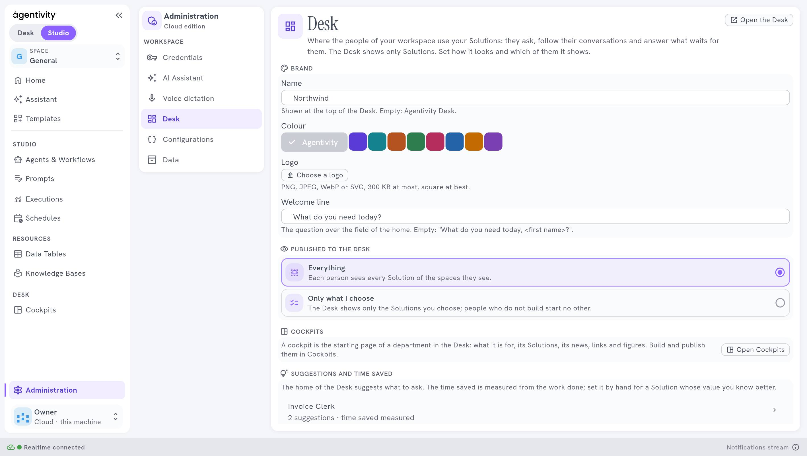

<!-- GENERATED from agentivity_docs/fr/desk/brand-your-desk.md. Do not edit here: edit the source and publish again. -->

Vos collègues utilisent le Desk tous les jours. Faites-lui ressembler à votre entreprise, pas à un outil.

## Ce qu'il vous faut

Un rôle avec le droit de modifier les réglages.

## Régler la marque

Ouvrez **Administration** › **Desk**. En haut :

| Réglage | Ce qu'il fait |
|---|---|
| **Name** | Affiché en haut du Desk. Vide : **Agentivity Desk**. |
| **Colour** | La couleur du Desk. Choisissez **Agentivity**, ou une couleur de la palette. |
| **Logo** | PNG, JPEG, WebP ou SVG, 300 Ko au plus, carré de préférence. Sélectionnez **Choose a logo**, puis **Change** pour le remplacer. |
| **Welcome line** | La question au-dessus du champ de l'accueil. Par exemple `De quoi avez-vous besoin aujourd'hui ?`. Vide : « What do you need today, *prénom* ? ». |

Sélectionnez **Save**. Le Desk montre le changement à sa prochaine lecture, dans la demi-minute.

## Comment savoir que ça marche

Ouvrez le Desk : le nom et le logo sont en haut, la couleur sur les boutons, et votre mot d'accueil au-dessus du champ.

## Si ça ne marche pas

- **Le logo est refusé.** Il dépasse 300 Ko. Réduisez-le, ou utilisez un SVG.
- **La marque ne change pas.** Attendez une demi-minute, puis rechargez le Desk.

## Étape suivante

[Places et droits du Desk](/fr/docs/desk/seats-and-rights-of-the-desk/).
