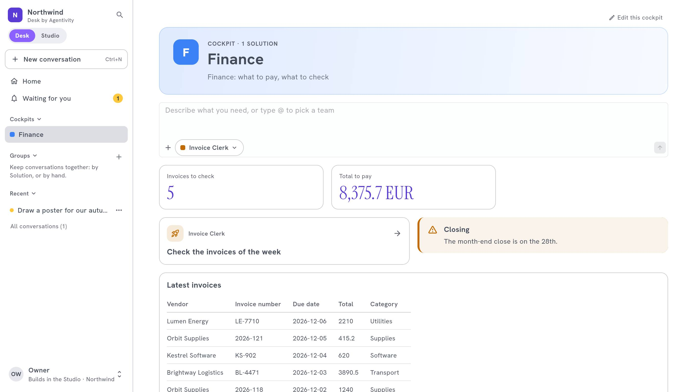
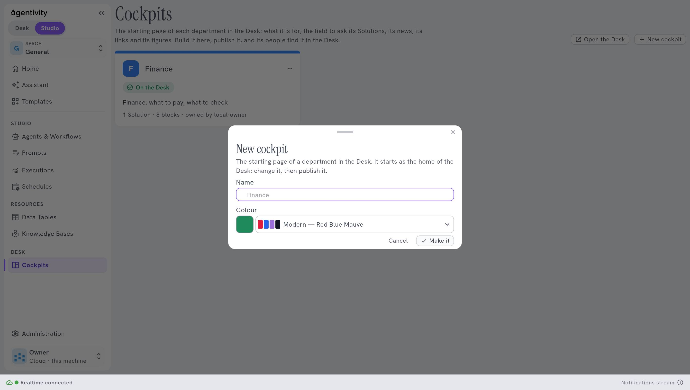
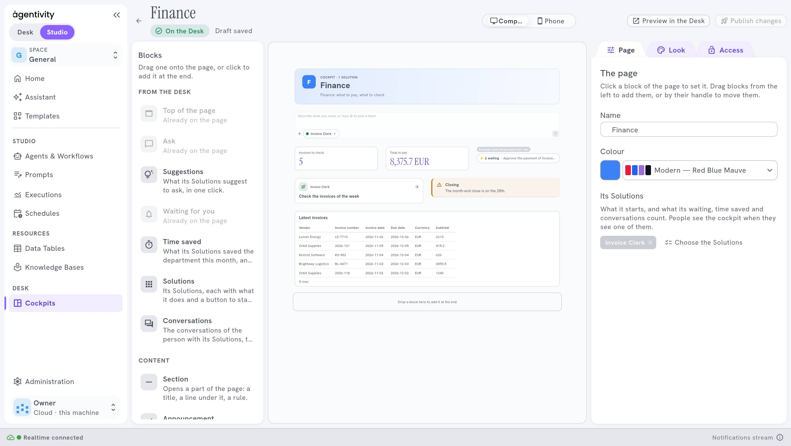

<!-- GENERATED from agentivity_docs/fr/desk/build-a-cockpit.md. Do not edit here: edit the source and publish again. -->

Un **cockpit** est la page de départ d'un département dans [Desk by Agentivity](/fr/docs/desk/agentivity-desk/) : Finance, Ventes, Support. Il dit à quoi sert le département, permet de demander à ses Solutions, montre ce qui attend chacun, et peut afficher des chiffres de vos Data Tables. Vous le construisez dans le Studio, dans un designer, et le publiez quand il est prêt.

## Pourquoi un cockpit

Sans cockpit, tout le monde part du même accueil et doit savoir quoi demander. Avec un cockpit, un département commence sa journée sur une page faite pour lui : ses Solutions, ses nouvelles, ses liens et ses chiffres. La Finance ne cherche pas les agents des Ventes, et les Ventes ne voient pas les factures.

## Ce qu'il vous faut

- Un espace de travail avec le Desk. Voyez [Les plans et leurs limites](/fr/docs/hosted/plans-and-limits/).
- Les Solutions du département, [publiées dans le Desk](/fr/docs/desk/publish-solutions-to-the-desk/).
- L'un des deux :
  - un rôle avec le droit « Make the cockpits of the Desk, change and publish any of them, choose their owners, order and delete them » ;
  - ou être **responsable** (owner) du cockpit.

## Qui fait quoi

| Qui | Ce qu'il peut faire |
|---|---|
| Une personne qui a le droit de faire les cockpits | Crée les cockpits, les ordonne, les supprime, et choisit leurs responsables. Modifie et publie n'importe quel cockpit. |
| Un **responsable** d'un cockpit | Modifie et publie ce cockpit. |

Les cockpits se construisent uniquement dans le Studio. **Administration** › **Desk** garde la marque du Desk, ce qui y est publié et les suggestions. Sa partie **Cockpits** n'a plus qu'un bouton, **Open Cockpits**, qui vous amène ici.

Un espace de travail compte jusqu'à 30 cockpits.

## Créer un cockpit

1. Dans le Studio, dans la barre latérale, sous **Desk**, sélectionnez **Cockpits**.
2. Sélectionnez **New cockpit**.
3. Donnez-lui un **Name**, par exemple `Finance`, et une **Colour**.
4. Sélectionnez **Make it**. Le designer s'ouvre sur le nouveau cockpit.

Un nouveau cockpit part de l'accueil du Desk. Modifiez-le, puis publiez-le. D'ici là, il indique **Not published** : personne ne le voit dans le Desk.

Dans la liste, le menu d'un cockpit propose **Open the designer** (pour y revenir plus tard), **See it in the Desk**, **Move up**, **Move down**, **Take it off the Desk** et **Delete**. **Move up** et **Move down** fixent l'ordre des cockpits dans la barre latérale du Desk.

## Le designer

Le designer a trois parties :

- **À gauche, Blocks.** Glissez un bloc sur la page, ou cliquez dessus pour l'ajouter à la fin. Voyez [Les blocs d'un cockpit](/fr/docs/desk/cockpit-blocks/).
- **Au centre, la page**, telle que le Desk la dessine. Passez de **Computer** à **Phone** pour voir les deux.
- **À droite, les réglages**, en onglets :
  - sans bloc sélectionné, la page : **Page** (son nom, sa couleur, ses Solutions), **Look** (son style) et **Access** (ses responsables et sa publication) ;
  - avec un bloc sélectionné, ce bloc : **Content** et **Look**.

Sur un bloc, les boutons règlent sa largeur, le dupliquent (**Duplicate**) ou le retirent (**Remove from the page**). Faites glisser un bloc pour le déplacer. Un cockpit compte jusqu'à 40 blocs. Voyez [Mettre en page et styler un cockpit](/fr/docs/desk/lay-out-and-style-a-cockpit/).

### Choisir ses Solutions

Dans l'onglet **Page**, choisissez les Solutions du département : jusqu'à 100. Elles décident qui voit le cockpit, et ce que ses blocs proposent.

## Brouillon et publication

Vos changements sont un brouillon. Le designer l'enregistre tout seul et dit **Draft saved**.

| Bouton | Ce qu'il fait |
|---|---|
| **Preview in the Desk** | Montre le brouillon dans le Desk, comme les gens le verront. Personne d'autre ne le voit. |
| **Publish** | Met le brouillon dans le Desk. Une fois publié, le bouton dit **Publish changes** quand vous changez quelque chose. |
| **Discard changes** | Revient à ce qui est publié. |

Pour retirer un cockpit du Desk sans le supprimer, sélectionnez **Take it off the Desk**, dans l'onglet **Access** ou dans son menu dans la liste. **Delete the cockpit** supprime sa page et ses blocs. Ses Solutions et leurs conversations restent. C'est définitif.

## Les responsables

1. Ouvrez le cockpit dans le designer, sans bloc sélectionné.
2. Ouvrez l'onglet **Access**.
3. Sous **Add an owner**, tapez son e-mail et sélectionnez **Add**.

Un responsable modifie et publie ce cockpit. Un cockpit a jusqu'à 20 responsables. Seule une personne qui a le droit de faire les cockpits choisit les responsables. Cela permet à la responsable d'un département de tenir sa page à jour sans aucun autre droit.

## Qui voit un cockpit

- Une personne voit un cockpit quand elle voit au moins une de ses Solutions publiées dans le Desk.
- Un cockpit sans Solution est vu par tout le monde dans le Desk.

## Comment savoir que ça marche

L'onglet **Access** dit **On the Desk**, avec la date de publication. Dans le Desk, le cockpit apparaît dans la barre latérale sous **Cockpits**, et sa page ressemble à ce qu'elle était dans le designer.

## Si ça ne marche pas

- **Quelqu'un ne voit pas le cockpit.** Il ne voit aucune de ses Solutions. Vérifiez que les Solutions sont publiées dans le Desk et que ses droits lui permettent d'en voir une.
- **Vos changements n'apparaissent pas dans le Desk.** Ils sont encore un brouillon. Sélectionnez **Publish changes**.
- **Vous ne pouvez pas ajouter de bloc.** Le cockpit en compte déjà 40.

## Étape suivante

[Les blocs d'un cockpit](/fr/docs/desk/cockpit-blocks/).
