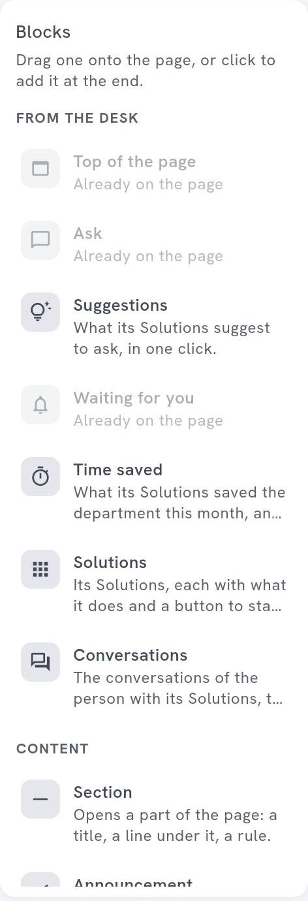

<!-- GENERATED from agentivity_docs/fr/desk/cockpit-blocks.md. Do not edit here: edit the source and publish again. -->

Un cockpit est une page faite de blocs. Cette page dit ce que fait chaque bloc et quand l'utiliser.

## Ce qu'il vous faut

Un cockpit ouvert dans le designer. Voyez [Construire un cockpit](/fr/docs/desk/build-a-cockpit/).

La liste de gauche a deux groupes : **From the Desk** (les blocs qui viennent du Desk lui-même) et **Content** (ceux que vous écrivez). Un bloc qui ne peut être qu'une fois sur la page, comme **Top of the page**, **Ask** ou **Waiting for you**, dit **Already on the page** quand il y est.

## Lancer une demande

| Bloc | Ce qu'il montre | À quoi il sert |
|---|---|---|
| **Ask** | Le champ pour demander à une des Solutions du cockpit, en écrivant, en dictant ou en ajoutant une image. | L'entrée principale du département. |
| **Suggestions** | Des demandes à lancer d'un clic. | Apprendre quoi demander. |
| **Launch button** | Un bouton qui lance une Solution, avec la demande déjà écrite. | La demande fréquente, toujours la même : « Lancer la clôture du mois ». |
| **Solutions** | **All of its Solutions**, ou **Some**, celles que vous choisissez. | Montrer ce que le département sait faire. |

## Suivre le travail

| Bloc | Ce qu'il montre | À quoi il sert |
|---|---|---|
| **Waiting for you** | Ce qui attend la réponse de la personne dans ce cockpit. Rien ne s'affiche quand rien n'attend. | La raison de revenir chaque matin. |
| **Conversations** | Les conversations de la personne avec ses Solutions. | Reprendre là où elle s'était arrêtée. |
| **Time saved** | Ce que ses Solutions ont fait gagner au département ce mois-ci, et la part de la personne. | Montrer la valeur. |

## Montrer des chiffres

| Bloc | Ce qu'il montre | À quoi il sert |
|---|---|---|
| **Indicator** | Un chiffre d'une Data Table : le nombre de lignes, ou le total, la moyenne, le minimum ou le maximum d'une colonne. **Only the rows where** filtre les lignes. | « Factures à valider : 12 ». |
| **Table** | Les dernières lignes d'une Data Table, **Latest first** ou **Oldest first**. | Les dernières commandes, les derniers tickets. |

Un bloc **Indicator** ou **Table** montre ses données à tous ceux qui voient le cockpit, même aux personnes sans droit de lire les Data Tables. Choisissez avec soin ce que vous montrez. Pour ajouter une Data Table à un cockpit, il vous faut le droit de lire les Data Tables. La fenêtre **Which Data Table?** le dit.

## Dire des choses

| Bloc | Ce qu'il montre | À quoi il sert |
|---|---|---|
| **Top of the page** | Le nom du département et ce à quoi il sert, dans sa couleur. | Le premier bloc d'une page. |
| **Announcement** | Un message, avec un ton (**News**, **Good news**, **Warning**) et une date à laquelle il cesse de s'afficher. **Always** le garde. | Une date de clôture, un nouvel outil, un incident. |
| **Text** | Des paragraphes. Une ligne qui commence par `- ` est une liste. | Une règle du département, un rappel. |
| **Section** | Un titre, un sous-titre et un trait, pour ouvrir une partie de la page. | Découper une longue page. |

## Renvoyer ailleurs

| Bloc | Ce qu'il montre | À quoi il sert |
|---|---|---|
| **Links** | Des liens vers d'autres endroits. Une adresse commence par `https://`, `http://` ou `mailto:`. | L'intranet, la politique, l'adresse du support. |
| **Card** | Une image, un titre, un texte et un lien vers un autre endroit : l'intranet, un outil, un site. | Une destination importante, avec une image. |

## Ajouter, déplacer et changer un bloc

- **Ajouter.** Glissez un bloc de la gauche sur la page, ou cliquez dessus pour l'ajouter à la fin.
- **Déplacer.** Faites-le glisser.
- **La largeur.** Utilisez les boutons du bloc. Voyez [Mettre en page et styler un cockpit](/fr/docs/desk/lay-out-and-style-a-cockpit/).
- **Duplicate** le copie, avec ses réglages. **Remove from the page** le retire.
- **Content** est ce qu'il dit. **Look** est son apparence.

## Comment savoir que ça marche

Dans **Preview in the Desk**, le bloc s'affiche avec son contenu. Les blocs qui dépendent de la personne (**Waiting for you**, **Conversations**, **Time saved**) montrent ses propres données.

## Si ça ne marche pas

- **Un bloc ne montre rien.** **Waiting for you** ne montre rien quand rien n'attend.

## Étape suivante

[Mettre en page et styler un cockpit](/fr/docs/desk/lay-out-and-style-a-cockpit/).
