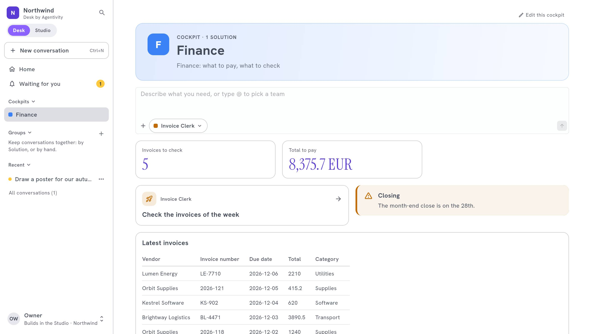

<!-- GENERATED from agentivity_docs/fr/desk/cockpit-examples.md. Do not edit here: edit the source and publish again. -->

Un cockpit n'est pas un tableau de bord à regarder. C'est une page pour démarrer. En voici trois, construits avec les [blocs](/fr/docs/desk/cockpit-blocks/) du designer. Changez les noms pour les vôtres.

## Ce qu'il vous faut

- Les Solutions du département, [publiées dans le Desk](/fr/docs/desk/publish-solutions-to-the-desk/).
- Pour les chiffres, une Data Table alimentée par vos workflows, et le droit de lire les Data Tables.

## Finance : les factures

**Solutions :** l'agent qui lit les factures, le workflow qui les compare aux commandes, la validation des paiements.

| Bloc | Largeur | Réglage |
|---|---|---|
| **Top of the page** | Full width | « Finance : quoi payer, quoi vérifier » |
| **Ask** | Full width | |
| **Indicator** | A third | Factures à valider : lignes de la table `Invoices`, **Only the rows where** le statut vaut `à valider` |
| **Indicator** | A third | Total de la colonne `Amount` de ces lignes |
| **Waiting for you** | A third | |
| **Launch button** | Half | « Vérifier les factures du jour » |
| **Announcement** | Half | **Warning** : « Clôture le 28 », avec une date à laquelle il cesse de s'afficher |
| **Table** | Full width | Les dernières lignes de `Invoices`, **Latest first** |

Pourquoi ça marche : la personne voit ce qui attend, lance le travail du jour en un clic, et voit les chiffres qui comptent.

## Ventes : les relances

**Solutions :** l'agent qui écrit les e-mails de relance, l'équipe qui prépare une visite.

| Bloc | Largeur | Réglage |
|---|---|---|
| **Top of the page** | Full width | « Ventes : les relances du jour » |
| **Ask** | Two thirds | |
| **Suggestions** | A third | « Écrire une relance au client d'hier » |
| **Indicator** | A third | Opportunités ouvertes |
| **Time saved** | A third | |
| **Card** | Half | Le CRM, avec son lien |
| **Links** | Half | La politique de prix, le modèle de contrat |

## Support : la file

**Solutions :** l'agent qui rédige des réponses, le workflow qui trie les tickets.

| Bloc | Largeur | Réglage |
|---|---|---|
| **Top of the page** | Full width | « Support : répondre plus vite » |
| **Waiting for you** | Half | Réponses à valider |
| **Conversations** | Half | Les conversations en cours |
| **Indicator** | A third | Tickets du jour |
| **Announcement** | Two thirds | **News** : l'incident de ce matin |
| **Text** | Full width | Le ton d'une réponse : trois règles courtes |

## Construire le vôtre

1. Listez ce que fait le département chaque jour : ce sont ses Solutions.
2. Mettez en premier ce que les gens font en premier : **Ask** et **Launch button**.
3. Ajoutez ce qui attend, puis les chiffres, puis les nouvelles.
4. Prévisualisez sur téléphone, retirez ce qui n'est pas nécessaire, et [publiez](/fr/docs/desk/build-a-cockpit/).

## Comment savoir que ça marche

Une personne du département ouvre le Desk et démarre sa journée depuis le cockpit, sans vous demander où sont les choses.

## Étape suivante

[Desk by Agentivity](/fr/docs/desk/agentivity-desk/) : le plan de la section.
