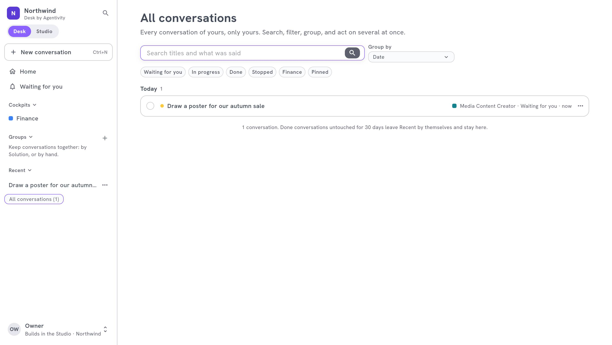
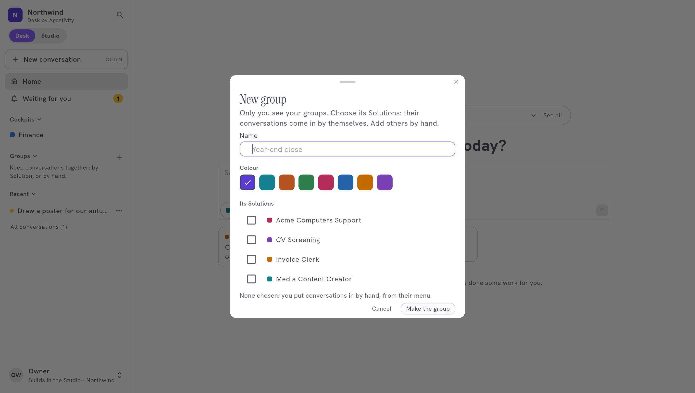

<!-- GENERATED from agentivity_docs/fr/desk/find-and-manage-conversations.md. Do not edit here: edit the source and publish again. -->

Chaque demande que vous faites est une conversation. Après quelques semaines, elles sont nombreuses. Le Desk vous aide à les retrouver et à les ranger.

## La barre latérale

| Élément | Ce qu'il montre |
|---|---|
| **Home** | Le champ pour demander, et ce qui est au-dessus. |
| **Waiting for you** | Toutes les conversations qui attendent votre réponse. Voyez [Répondre à ce qui vous attend](/fr/docs/desk/answer-what-waits-for-you/). |
| **Cockpits** | La page de départ de chaque département. |
| **Groups** | Vos propres groupes de conversations. |
| **Recent** | Vos dernières conversations. |
| **All conversations** | Toutes vos conversations, avec leur recherche. |
| **Archived (n)** | Les conversations que vous avez mises de côté. Il apparaît dès que vous en avez archivé une. |

Sélectionnez le titre **Cockpits**, **Groups** ou **Recent** pour replier la rubrique, et à nouveau pour l'ouvrir. Votre navigateur se souvient de la façon dont vous les avez laissées. Une conversation terminée qu'on n'a pas touchée depuis 30 jours quitte **Recent** toute seule et reste dans **All conversations**.

## All conversations

**All conversations** liste toutes vos conversations, et seulement les vôtres.

- **La recherche.** Elle porte sur les titres et sur ce qui a été dit.
- **Les filtres.** **Waiting for you**, **In progress**, **Done**, **Stopped**, un par cockpit, et **Pinned**.
- **Group by.** Les range par **Solution**, **Cockpit**, **Group**, **Status** ou **Date**.
- **Plusieurs à la fois.** Cochez plusieurs conversations pour agir sur toutes.

## Agir sur une conversation

Ouvrez le menu d'une conversation (**More**) :

| Action | Ce qu'elle fait |
|---|---|
| **Rename** | Lui donne un titre à vous, 200 caractères au plus. Vide, elle retrouve ses premiers mots. |
| **Pin** | La garde en haut. **Unpin** la remet à sa place. |
| **Put in a group** | La range dans un de vos groupes. |
| **Archive** | La déplace dans **Archived**. |
| **Stop** | La conversation travaille encore, ou vous attend. Plus rien n'est fait, et plus rien ne vous y attend. |
| **Close** | Le travail est fini. Vous pouvez encore la lire, mais plus y écrire. |
| **Delete** | Supprime la conversation, ce qui a été dit et ce qu'elle a produit, après confirmation. C'est définitif. |

Seule la personne qui a lancé une conversation peut la supprimer. Pour la mettre à l'écart sans la perdre, **Archive**.

## Archiver et restaurer

**Archived (n)** liste les conversations mises de côté. **Restore** en remet une dans vos listes.

Une conversation archivée ne compte plus dans **Waiting for you**, dans les groupes, dans les cockpits ni dans **All conversations**. Ouverte, elle montre encore sa question si elle en attend une.

## Les groupes

Un groupe est un dossier à vous. Personne d'autre ne le voit.

1. Dans la barre latérale, sélectionnez **+** à côté de **Groups**. La fenêtre **New group** s'ouvre.
2. Donnez-lui un nom, par exemple `Clôture annuelle`, et une couleur.
3. Choisissez **Its Solutions** : les conversations de ces Solutions y entrent toutes seules. Ou n'en choisissez aucune, et rangez les conversations à la main avec **Put in a group**.
4. Sélectionnez **Make the group**.

Pour le modifier, ouvrez **Edit the group**. **Delete the group** garde ses conversations, sans groupe.

## Partager une conversation

1. Dans la conversation, sélectionnez **Share**.
2. Tapez l'e-mail d'un collègue de votre espace de travail.
3. Laissez **They may reply in it too** désactivée pour qu'il puisse seulement lire. Activez-la pour qu'il puisse répondre.
4. Sélectionnez **Share**.

Sous **Shared with**, chaque collègue apparaît avec **Reads** ou **Reads and replies**. **Stop sharing** à côté d'un nom y met fin. Un collègue quitte une conversation partagée avec **Leave this conversation**.

Les titres, épingles, archives et groupes d'une conversation partagée sont à vous : chacun garde les siens.

## Quand une conversation quitte le Desk

Une conversation quitte le Desk quand son agent, son équipe ou son workflow est supprimé, ou n'est plus marqué comme Solution. Elle reste dans **Executions** dans le Studio. Seul **Delete** l'efface.

## Comment savoir que ça marche

La conversation apparaît là où vous l'avez mise : dans son groupe, en haut une fois épinglée, ou dans **Archived (n)**.

## Si ça ne marche pas

- **Une conversation manque.** Regardez **Archived (n)**. Si elle n'y est pas, son agent, son équipe ou son workflow a été supprimé ou n'est plus une Solution publiée : cherchez-la dans **Executions** dans le Studio.
- **Vous ne pouvez pas supprimer une conversation.** Quelqu'un d'autre l'a lancée. Seule cette personne le peut.
- **Vous ne pouvez pas écrire dans une conversation.** Elle est close, ou elle est partagée avec vous en lecture.

## Étape suivante

[Construire un cockpit](/fr/docs/desk/build-a-cockpit/) pour un département.
