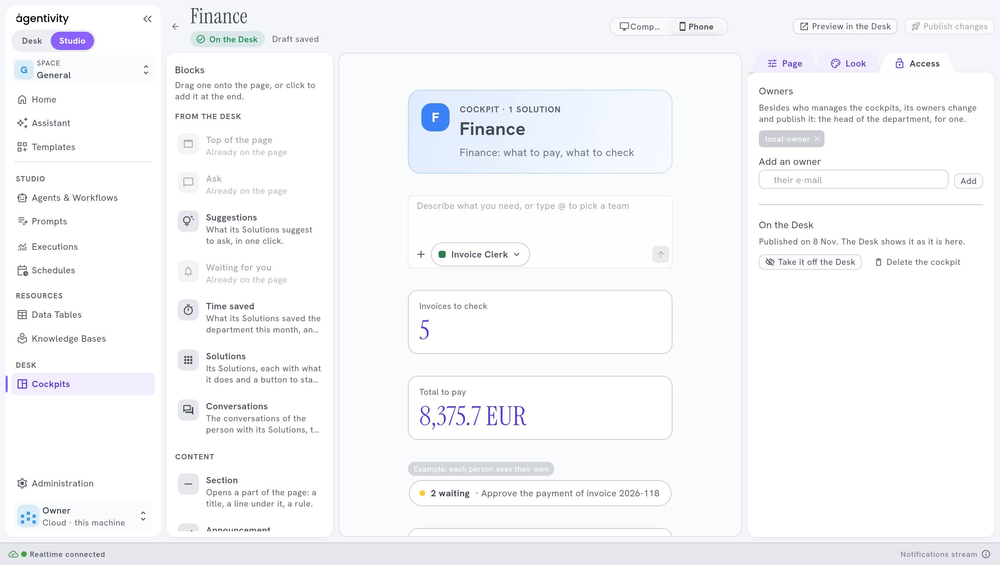
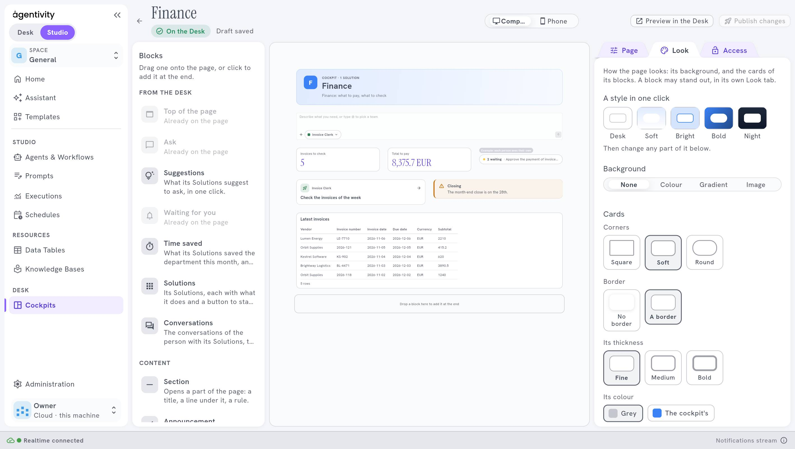

<!-- GENERATED from agentivity_docs/fr/desk/lay-out-and-style-a-cockpit.md. Do not edit here: edit the source and publish again. -->

Un bon cockpit se lit d'un coup d'œil : quoi faire en premier, ce qui attend, ce qui est nouveau. La mise en page et le style y contribuent beaucoup.

## Ce qu'il vous faut

Un cockpit ouvert dans le designer. Voyez [Construire un cockpit](/fr/docs/desk/build-a-cockpit/).

## La largeur d'un bloc

La page est coupée en douze. Un bloc prend :

| Largeur | De la page |
|---|---|
| **A third** | 4 parts : trois blocs côte à côte |
| **Half** | 6 parts : deux blocs côte à côte |
| **Two thirds** | 8 parts : un grand bloc et un tiers à côté |
| **Full width** | Toute la largeur |

Les blocs qui tiennent sur une ligne se placent côte à côte ; le suivant passe à la ligne. Sur un téléphone, tous les blocs passent en une colonne, dans l'ordre de la page.

Passez de **Computer** à **Phone** au-dessus de la page pour voir les deux.

## Une mise en page qui marche

1. **Top of the page** en pleine largeur : pour qui est la page.
2. **Ask** en pleine largeur, pour que les gens partent de là.
3. En dessous, une ligne de trois blocs **Indicator**, un tiers chacun : les chiffres à surveiller.
4. Puis **Waiting for you** en moitié, et **Announcement** en moitié.
5. En bas, des blocs **Links** ou **Card**.

Gardez les blocs importants en haut : sur un téléphone, ils passent en premier. Une page pleine de blocs est une page que personne ne lit. Découpez-la avec une **Section**.

Pour des exemples par département, voyez [Idées de cockpit par département](/fr/docs/desk/cockpit-examples/).

## Le style

Dans l'onglet **Look** de la page :

- **Un style en un clic** : **Desk**, **Soft**, **Bright**, **Bold** ou **Night**. Partez de l'un d'eux, puis changez ce que vous voulez.
- **Le fond** : **None**, **Colour**, **Gradient** ou **Image**.
- **Les cartes** : leurs **Corners** (**Square**, **Soft** ou **Round**), leur **Border** (**No border** ou **A border**), son épaisseur (**Fine**, **Medium** ou **Bold**) et sa couleur (**Grey** ou **The cockpit's**).

Un bloc peut avoir son propre style, dans son onglet **Look**. Choisissez une couleur dans les palettes, ou n'importe quelle couleur avec le sélecteur. Servez-vous-en pour un bloc qui doit ressortir, comme un **Warning**.

## Les images

Choisissez une image sur votre ordinateur, 1 Mo au plus et 12 par cockpit, en PNG, JPEG, WebP ou GIF. Ou donnez son adresse, qui commence par `https://`.

## Rester lisible

- Un seul style pour toute la page. Un bloc au style propre est une exception.
- Vérifiez la page dans **Preview in the Desk**, sur ordinateur et sur téléphone.

## Comment savoir que ça marche

**Preview in the Desk** montre la page comme les gens la voient, sur ordinateur et sur téléphone, avant que vous la publiiez.

## Si ça ne marche pas

- **Une image est refusée.** Elle dépasse 1 Mo, ou le cockpit contient déjà 12 images. Réduisez-la, ou donnez son adresse.
- **La page téléphone est longue.** Tous les blocs y passent en une colonne : retirez ce qui n'est pas nécessaire.

## Étape suivante

[Idées de cockpit par département](/fr/docs/desk/cockpit-examples/).
