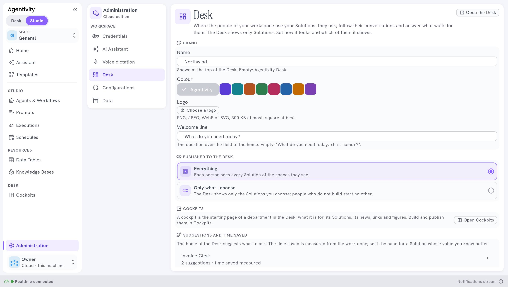

<!-- GENERATED from agentivity_docs/fr/desk/publish-solutions-to-the-desk.md. Do not edit here: edit the source and publish again. -->

Une Solution n'apparaît dans le Desk que si vous l'y publiez. Vous décidez dans **Administration** › **Desk**, sous **Published to the Desk**.

## Ce qu'il vous faut

- Un rôle avec le droit de modifier les réglages.
- Des Solutions : des agents, équipes ou workflows marqués comme Solutions. Voyez [Ce qu'est une Solution, et comment la marquer](/fr/docs/introduction/what-a-solution-is/).

## Choisir ce qui est publié

Ouvrez **Administration** › **Desk**. Sous **Published to the Desk**, choisissez :

| Choix | Ce que le Desk montre |
|---|---|
| **Everything** | Chaque personne voit toutes les Solutions des espaces qu'elle voit. |
| **Only what I choose** | Seulement les Solutions que vous choisissez. Les personnes qui ne construisent pas n'en lancent aucune autre. |

Avec **Only what I choose**, sélectionnez **Choose the Solutions**, cochez-les, puis **Save**. Tant que vous n'en avez choisi aucune, le Desk ne montre rien et le dit.

Le Desk lit le changement dans la demi-minute.

Une personne ne voit une Solution publiée que si ses droits lui permettent de la voir. Publier n'est pas une façon de donner un droit.

## Écrire les suggestions de l'accueil

L'accueil du Desk suggère des demandes à lancer d'un clic. Sous **Suggestions and time saved** :

1. Sélectionnez **Suggest for a Solution** et choisissez la Solution.
2. Écrivez une à plusieurs suggestions, chacune comme la personne la demanderait. Par exemple : `Vérifier la facture 2026-118 avec sa commande`.
3. Sélectionnez **Save**.

Une bonne suggestion est une vraie demande, courte, avec le genre de détail qu'une personne donne. Elle apprend aux gens quoi demander.

## Régler le temps gagné

Le Desk montre à chaque personne le temps que vos Solutions lui ont fait gagner. Il est mesuré d'après le travail fait. Pour une Solution dont vous connaissez mieux la valeur, réglez **Minutes saved each time**, entre 0 et 1440. Vide : mesuré.

## Ouvrir une Solution dans le Desk

Depuis le Studio, le menu d'une Solution dans **Agents & Workflows** propose **Open in Desk**. Il ouvre le Desk sur cette Solution, pour l'essayer comme vos collègues.

## Comment savoir que ça marche

Ouvrez le Desk avec **Open the Desk**, en haut du volet. Les Solutions que vous avez choisies sont dans le champ pour demander, et les suggestions sont sur l'accueil.

## Si ça ne marche pas

- **Une Solution manque dans le Desk.** Elle n'est pas publiée, elle n'est pas marquée comme Solution, ou les droits de la personne ne lui permettent pas de la voir.
- **Le Desk dit qu'aucune Solution n'est publiée pour vous.** Rien n'est choisi sous **Only what I choose**, ou aucune des Solutions choisies n'est visible pour cette personne.
- **Une Solution retirée s'affiche encore.** Attendez une demi-minute et rechargez.

## Étape suivante

[Donner au Desk votre marque](/fr/docs/desk/brand-your-desk/).
