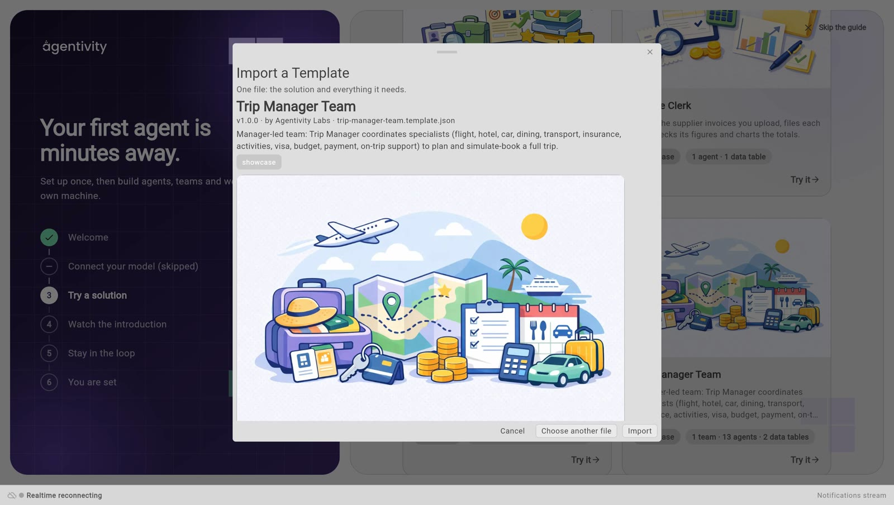
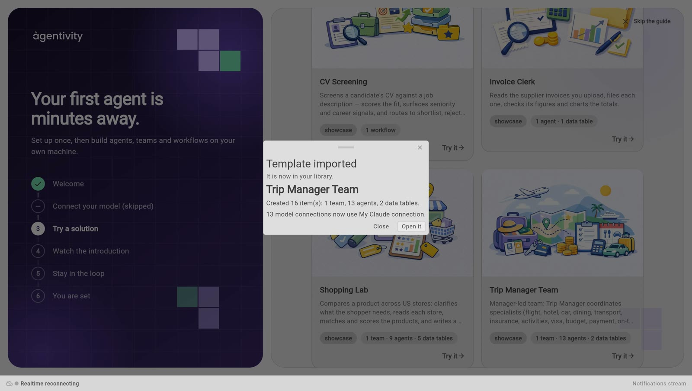
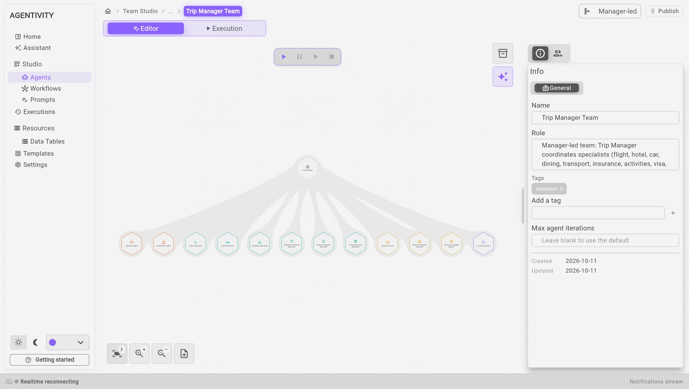

<!-- GENERATED from agentivity_docs/fr/getting-started/try-a-ready-made-solution.md. Do not edit here: edit the source and publish again. -->

Le moyen le plus rapide de comprendre Agentivity, c'est d'ouvrir une Solution déjà construite. Agentivity propose des Solutions de démonstration sous forme de Templates. Un Template est un fichier unique qui contient une Solution et tout ce dont elle a besoin : ses agents, son équipe ou son workflow, et ses Data Tables.

<video controls muted playsinline preload="metadata" src="/docs-media/fr/getting-started/images/import-a-showcase.mp4" aria-label="Un enregistrement du Studio : Try it est sélectionné sur la carte Trip Manager Team, la fenêtre Import a Template s'ouvre, Import est sélectionné, le message Template imported apparaît, et l'équipe s'ouvre dans son éditeur"></video>

Enregistré depuis le produit, accéléré.

## Ce dont vous avez besoin

- Agentivity qui tourne, avec le Studio ouvert. Voyez [Installer Agentivity avec Docker](/fr/docs/getting-started/install-community/).
- Une connexion Internet sur la machine où tourne Agentivity. Les Templates sont téléchargés depuis le catalogue d'Agentivity.
- Pour faire tourner la Solution, et pas seulement la regarder : une connexion à un modèle. Voyez [Connecter un modèle d'IA](/fr/docs/guides/connect-a-model/).

## Les Solutions de démonstration

| Solution | Ce qu'elle contient | Ce qu'elle fait |
|---|---|---|
| **Trip Manager Team** | 1 équipe, 13 agents, 2 Data Tables | Un manager et ses spécialistes organisent un voyage complet : vol, hôtel, voiture, restaurants, transports. Les réservations sont simulées. |
| **Shopping Lab** | 1 équipe, 9 agents, 5 Data Tables | Compare un produit dans plusieurs magasins et rédige une recommandation. |
| **Invoice Clerk** | 1 agent, 1 Data Table | Lit les factures fournisseurs que vous déposez, classe chacune et vérifie ses montants. |
| **CV Screening** | 1 workflow | Compare un CV à une offre d'emploi et propose quoi en faire. |

## Importer une Solution

Depuis le guide de bienvenue :

1. Ouvrez le [guide de bienvenue](/fr/docs/getting-started/welcome-guide/) et allez à l'étape **Try a first solution**.
2. Sur la carte de la Solution, sélectionnez **Try it**. La fenêtre **Import a Template** s'ouvre. Elle montre le nom du Template, son auteur et ce que l'import va créer.

3. Sélectionnez **Import**.
4. Attendez le message **Template imported**. Il liste ce qui a été créé, par exemple « Created 16 item(s): 1 team, 13 agents, 2 data tables. »
5. Sélectionnez **Open it**.

L'import crée toujours de nouvelles copies. Rien de ce que vous avez déjà n'est modifié.

Vous pouvez aussi partir du Studio : sur la page d'accueil, sélectionnez **Browse templates**. La section **Templates** s'ouvre. Sélectionnez un Template pour voir ce qu'il contient et comment il est construit, puis sélectionnez **Import**.

## Le modèle des agents importés

Les agents d'un Template ont été configurés avec la connexion au modèle de leur auteur. Cette connexion n'existe pas sur votre serveur. L'import la remplace donc :

- **Si vous avez une connexion à un modèle**, les agents importés utilisent la vôtre. Le message **Template imported** indique laquelle, par exemple « 13 model connections now use » suivi du nom de votre connexion.
- **Si vous n'avez pas encore de connexion à un modèle**, l'import fonctionne quand même, mais les agents échouent à leur premier lancement. Ajoutez une connexion dans **Settings** > **Credentials**. Allez ensuite dans **Studio** > **Agents**, ouvrez le menu de l'élément importé et sélectionnez **Use my default model**.

## Comment savoir que ça marche

La Solution s'ouvre dans son éditeur et vous la voyez dessinée sur le canevas.

Pour **Trip Manager Team**, vous voyez le manager en haut et ses spécialistes en dessous. Les agents importés et l'équipe se trouvent aussi dans **Studio** > **Agents**.

## Si ça ne marche pas

- **« The marketplace could not be reached. »** La machine où tourne Agentivity ne peut pas joindre le catalogue de Templates. Vérifiez sa connexion Internet.
- **Vous avez reçu un Template sous forme de fichier.** Dans le Studio, ouvrez **Templates**, sélectionnez **Import from file** et choisissez le fichier.
- **« This file is not a JSON document. »** Le fichier que vous avez choisi n'est pas un Template.

## En savoir plus sur chaque démonstration

[Les quatre démonstrations et ce que chacune enseigne](/fr/docs/showcases/the-four-showcases/) explique comment chacune est construite et ce qu'il faut regarder.

## Étape suivante

[Lancer une équipe et lire son travail](/fr/docs/teams/run-a-team/), avec l'équipe que vous venez d'importer. Ou [construisez votre propre équipe avec l'Assistant](/fr/docs/getting-started/build-your-first-team-with-the-assistant/).
