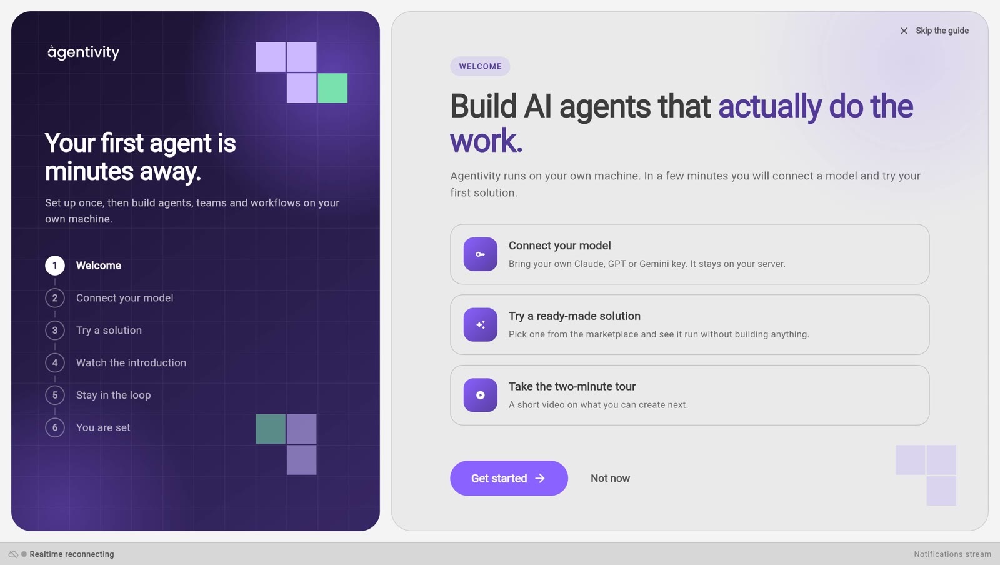
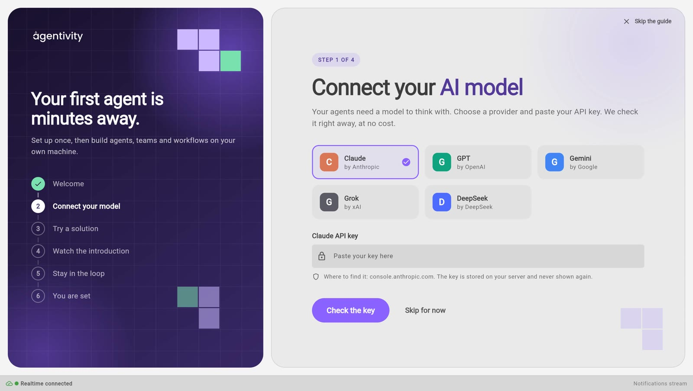

<!-- GENERATED from agentivity_docs/fr/getting-started/welcome-guide.md. Do not edit here: edit the source and publish again. -->

La première fois que vous ouvrez le Studio, un guide de bienvenue apparaît. Il compte quatre étapes courtes. Vous pouvez passer n'importe quelle étape et y revenir plus tard.

## Ce dont vous avez besoin

- Agentivity qui tourne, avec le Studio ouvert dans votre navigateur. Sinon, commencez par [Installer Agentivity avec Docker](/fr/docs/getting-started/install-community/).
- Pour l'étape 1, une clé API d'un fournisseur de modèles d'IA. Une clé API est un code secret qui permet à Agentivity d'utiliser votre compte chez ce fournisseur.
- Pour l'étape 2, une connexion Internet sur la machine où tourne Agentivity.

## Lancer le guide

L'écran de bienvenue montre ce que couvre le guide : **Connect your model**, **Try a ready-made solution** et **Take the two-minute tour**.

1. Sélectionnez **Get started**.

Si vous préférez d'abord jeter un œil, sélectionnez **Not now** ou **Skip the guide**. Voyez [Rouvrir le guide](#rouvrir-le-guide).

## Étape 1 : connecter votre modèle d'IA

Vos agents ont besoin d'un modèle d'IA pour réfléchir.

1. Choisissez votre fournisseur : **Claude**, **GPT**, **Gemini**, **Grok** ou **DeepSeek**.
2. Collez votre clé API dans le champ, puis sélectionnez **Check the key**. Agentivity demande au fournisseur si la clé fonctionne. Rien n'est encore enregistré. Si le fournisseur refuse la clé, son message s'affiche.
3. Choisissez le modèle. C'est obligatoire. La liste contient les modèles que votre clé peut utiliser. Si la liste n'est pas disponible, tapez l'ID du modèle.
4. Sélectionnez **Save**. La connexion est enregistrée avec sa clé et son modèle. Vous pourrez changer de modèle plus tard, dans **Credentials**.

La clé est stockée sur votre serveur et n'est plus jamais affichée.

Pour le faire plus tard, sélectionnez **Skip for now**. La page [Connecter un modèle d'IA](/fr/docs/guides/connect-a-model/) explique cette étape en détail.

## Étape 2 : essayer une première Solution

Une Solution, c'est ce que vous lancez pour qu'un besoin soit pris en charge de bout en bout. Cette étape propose des Solutions prêtes à l'emploi : vous en voyez une fonctionner avant de construire quoi que ce soit. Chaque carte indique ce que contient la Solution, par exemple « 1 team · 13 agents · 2 data tables ».

1. Sur la carte de la Solution qui vous intéresse, sélectionnez **Try it**. La fenêtre **Import a Template** s'ouvre. Un Template est un fichier unique qui contient une Solution et tout ce dont elle a besoin.
2. Sélectionnez **Import**.
3. Quand **Template imported** s'affiche, sélectionnez **Open it** pour ouvrir la Solution dans son éditeur, ou **Close** pour rester dans le guide.

L'import crée de nouvelles copies dans votre espace de travail. Rien de ce que vous avez déjà n'est modifié.

Les Solutions prêtes à l'emploi sont téléchargées depuis le catalogue de Templates d'Agentivity, par Internet. Si le catalogue est injoignable, le guide vous le signale et vous laisse continuer. Vous pourrez importer des Templates plus tard, dans la section **Templates**.

Pour plus de détails, lisez [Essayer une Solution prête à l'emploi](/fr/docs/getting-started/try-a-ready-made-solution/).

## Étape 3 : regarder l'introduction

Une courte vidéo montre ce que vous pouvez construire et par où commencer. Vous pouvez la passer.

## Étape 4 : rester informé

Vous pouvez donner votre adresse e-mail pour recevoir les nouvelles d'Agentivity : nouveaux Templates et nouvelles versions. Cette étape est facultative. Pour vous abonner, cochez la case pour donner votre accord, puis sélectionnez **Subscribe**. Vous recevez un seul e-mail de confirmation, et vous pouvez vous désabonner à tout moment.

## Comment savoir que ça marche

Le guide se termine sur l'écran **You are set**. Sélectionnez **Open my workspace** pour aller dans le Studio.

## Rouvrir le guide

Ce que vous avez passé n'est pas perdu. Dans le Studio, sélectionnez **Getting started**, en bas du menu de gauche. Le guide s'ouvre à nouveau.

## Si ça ne marche pas

- **« Paste your API key first. »** Le champ de la clé est vide.
- **La clé est refusée.** Le Studio affiche le message de votre fournisseur.
- **« The marketplace could not be reached. »** La machine où tourne Agentivity n'a pas accès au catalogue de Templates. Vérifiez sa connexion Internet, ou passez l'étape et importez un Template plus tard à partir d'un fichier.

## Étape suivante

[Vous repérer dans le Studio](/fr/docs/studio/find-your-way-in-the-studio/), puis [construire votre première équipe avec l'Assistant](/fr/docs/getting-started/build-your-first-team-with-the-assistant/).
