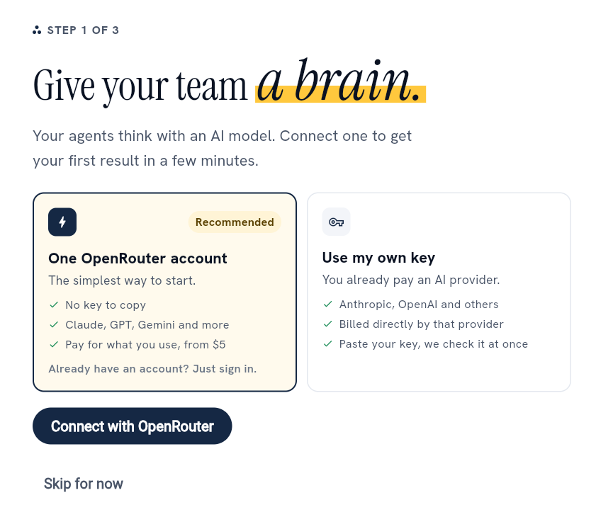
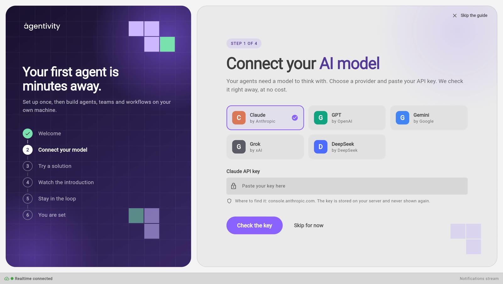

<!-- GENERATED from agentivity_docs/fr/getting-started/welcome-guide.md. Do not edit here: edit the source and publish again. -->

La première fois que vous ouvrez le Studio, un guide de bienvenue apparaît. En haut, trois repères montrent où vous en êtes : **Welcome**, **Model** et **Ready**. Vous pouvez passer le guide et y revenir plus tard.

## Ce dont vous avez besoin

- Agentivity qui tourne, avec le Studio ouvert dans votre navigateur. Sinon, commencez par [Installer Agentivity avec Docker](/fr/docs/getting-started/install-community/).
- Pour l'étape **Model**, un compte OpenRouter, que vous pouvez créer en chemin, ou une clé API d'un fournisseur de modèles d'IA si vous préférez la vôtre. Une clé API est un code secret qui permet à Agentivity d'utiliser votre compte chez ce fournisseur. Sur un espace de travail hébergé, vous pouvez aussi avoir un code de crédit IA.

## Lancer le guide

<!-- IMAGE images/welcome-guide.jpg: Le premier écran du guide de bienvenue, avec les trois repères en haut, le titre « Start with one workflow. Grow to a whole AI company. », les boutons Let's start et Not now, et une carte marine qui liste les deux étapes pour démarrer. -->

Le premier écran dit « Start with one workflow. Grow to a whole AI company. » Choisissez un travail que vous faites à la main, et ajoutez des agents et des équipes à mesure que le travail grandit : vous gardez la main. Une carte, **Two steps to start**, liste la suite : **Connect a model**, puis **Tell Winston what you want to automate**.

1. Sélectionnez **Let's start**.

Si vous préférez d'abord jeter un œil, sélectionnez **Not now**, ou **Skip the guide** en haut à droite. Voyez [Rouvrir le guide](#rouvrir-le-guide).

## Étape 1 : connecter un modèle d'IA

Winston et vos agents ont besoin d'un modèle d'IA pour réfléchir. L'étape, appelée **One step before you start**, propose deux voies, dans deux cases :

- **One OpenRouter account**, marquée **Recommended** : pas de clé à copier, des modèles de plusieurs fournisseurs, et vous payez ce que vous utilisez. Si vous avez déjà un compte, vous vous connectez simplement.
- **Use my own key** : pour qui paye déjà un fournisseur d'IA, comme Anthropic ou OpenAI. Vous collez une clé, et Agentivity la vérifie aussitôt.

### Avec un compte OpenRouter

1. Gardez la première case et sélectionnez **Connect with OpenRouter**. Une fenêtre s'ouvre chez OpenRouter : créez un compte ou connectez-vous, puis sélectionnez **Authorize**.
2. Un nouveau compte n'a pas de crédit : le guide dit alors « One step left: add credit ». Sélectionnez **Add credit**, payez chez OpenRouter, puis revenez. Le guide voit le crédit tout seul, ou vous pouvez sélectionner **I've added credit**.
3. Quand le guide dit « Connected to OpenRouter. You are ready. », sélectionnez **Continue**.

Vous pourrez changer de modèle plus tard, dans **Administration** > **Credentials**. Tout ce qui concerne cette voie, y compris ce qui se passe quand le crédit s'épuise, est dans [Connect with OpenRouter](/fr/docs/guides/connect-with-openrouter/) (page en anglais).

### Avec votre propre clé

1. Sélectionnez **Use my own key**, puis choisissez votre fournisseur : **Claude**, **GPT**, **Gemini**, **Grok** ou **DeepSeek**. **Back to the choices** revient aux deux cases.
2. Collez votre clé API dans le champ, puis sélectionnez **Check the key**. Agentivity demande au fournisseur si la clé fonctionne. Rien n'est encore enregistré. Si le fournisseur refuse la clé, son message s'affiche.
3. Choisissez le modèle. C'est obligatoire. La liste contient les modèles que votre clé peut utiliser. Si la liste n'est pas disponible, tapez l'ID du modèle.
4. Sélectionnez **Save**. La connexion est enregistrée avec sa clé et son modèle. Vous pourrez changer de modèle plus tard, dans **Administration** > **Credentials**.

La clé est stockée sur votre serveur et n'est plus jamais affichée.

Sur un espace de travail hébergé, une troisième voie peut être proposée : **I have an AI credit code**. Collez le code qu'on vous a donné et sélectionnez **Use the code** : Agentivity paie les appels au modèle, jusqu'au crédit du code, et la connexion est faite aussitôt. La clé qui se cache derrière le code reste chez Agentivity.

Pour le faire plus tard, sélectionnez **Skip for now**. Si vous lancez un chat ou une exécution sans modèle connecté, le Studio propose les deux mêmes choix dans une fenêtre : rien n'est perdu. La page [Connecter un modèle d'IA](/fr/docs/guides/connect-a-model/) explique la voie de la clé personnelle en détail.

## Comment savoir que ça marche

Le guide se termine sur l'écran **Your workspace is ready.** Il demande « Where would you like to start? » et propose deux cartes : **Tell Winston what you want to automate** (il construit le déclencheur, les étapes, les agents et les équipes, et qui valide) et **Start from a Template** (des workflows, des agents et des équipes prêts à adapter). Sélectionnez **Open my workspace** pour aller dans le Studio. Si vous avez passé le modèle, l'écran dit d'en connecter un d'abord : Winston et vos agents en ont besoin pour travailler.

La première fois, une courte visite du Studio suit. Elle montre, un écran à la fois, ce qu'est le Studio, puis les workflows, les agents, les équipes, les connexions, Winston et le Desk avec ses cockpits. La visite se rouvre depuis **Getting started**, dans le menu de gauche, juste au-dessus de votre nom.

## Rouvrir le guide

Ce que vous avez passé n'est pas perdu. La visite du Studio se rouvre avec **Getting started**, dans le menu de gauche, juste au-dessus de votre nom. Le guide de démarrage lui-même reste dans le menu de votre compte, sous votre nom.

## Si ça ne marche pas

- **La fenêtre d'OpenRouter ne s'ouvre pas.** Votre navigateur a bloqué la fenêtre. Autorisez les fenêtres pour cette page, puis sélectionnez **Try again**.
- **« Paste your API key first. »** Le champ de la clé est vide.
- **La clé est refusée.** Le Studio affiche le message de votre fournisseur.
- **« Choose the model your agents will use. »** Choisissez un modèle dans la liste avant de sélectionner **Save**.

## Étape suivante

[Vous repérer dans le Studio](/fr/docs/studio/find-your-way-in-the-studio/), puis [construire votre première équipe avec Winston](/fr/docs/getting-started/build-your-first-team-with-the-assistant/).
