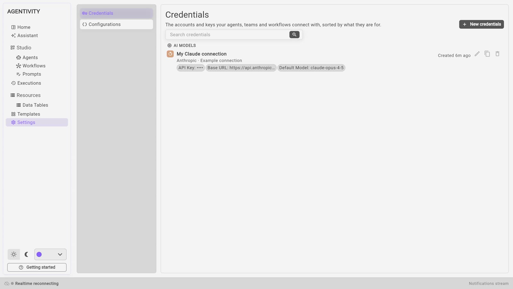

<!-- GENERATED from agentivity_docs/fr/guides/connect-a-model.md. Do not edit here: edit the source and publish again. -->

Les agents ont besoin d'un modèle d'IA pour réfléchir. Agentivity n'en fournit pas : vous apportez le vôtre. Vous ajoutez la clé API du fournisseur que vous utilisez, et vos agents tournent sur ce modèle.

## Ce dont vous avez besoin

- Agentivity qui tourne. Sinon, commencez par [Installer Agentivity avec Docker](/fr/docs/getting-started/install-community/).
- Une clé API d'un fournisseur, avec du crédit chez lui. C'est le fournisseur qui vous facture directement ce que vos agents utilisent.

## Où obtenir une clé

| Fournisseur | Famille de modèles | Où créer la clé |
|---|---|---|
| Anthropic | Claude | console.anthropic.com |
| OpenAI | GPT | platform.openai.com/api-keys |
| Google | Gemini | aistudio.google.com/apikey |
| xAI | Grok | console.x.ai |
| DeepSeek | DeepSeek | platform.deepseek.com |

## Connecter votre modèle la première fois

Le Studio est en anglais : les noms ci-dessous sont ceux de l'écran.

1. Ouvrez le Studio. Dans le guide de bienvenue, choisissez **Get started**, puis l'étape **Connect your AI model**.
2. Choisissez votre fournisseur.
3. Collez votre clé API, puis sélectionnez **Check the key**. Agentivity demande au fournisseur si la clé fonctionne. C'est gratuit, et rien n'est encore enregistré. Si le fournisseur refuse la clé, son message s'affiche.
4. Choisissez le modèle (**Model**). C'est obligatoire. La liste contient les modèles que votre clé peut utiliser, et vous pouvez taper dedans pour la filtrer. Si la liste n'a pas pu être chargée (un problème de réseau, ou une limite de votre fournisseur), tapez vous-même l'ID du modèle.
5. Sélectionnez **Save**. La connexion est enregistrée avec sa clé et son modèle.

**Comment savoir que ça marche :** la connexion est enregistrée, et le guide vous laisse continuer.

Vous pourrez changer de modèle plus tard, dans **Settings** > **Credentials**.

## Ajouter une autre connexion plus tard

Vous pouvez ajouter ou modifier une connexion à tout moment :

1. Dans le Studio, ouvrez **Settings**, puis **Credentials**.
2. Sélectionnez **New credentials**. La fenêtre **New connection** demande « What do you want to connect to? »
3. Sélectionnez **AI models**, puis votre fournisseur.
4. Remplissez le formulaire et enregistrez. Le formulaire est le même partout : ici, quand vous copiez une connexion, et quand l'Assistant vous en demande une.

Vous pouvez garder plusieurs connexions, par exemple une par fournisseur, et choisir sur laquelle tournent vos agents.

Cette liste propose plus de fournisseurs que le guide de bienvenue. Par exemple, elle propose aussi **AWS Bedrock** et **Cohere**.

## Les champs d'une connexion à un modèle d'IA

| Champ | Ce qu'il faut saisir |
|---|---|
| **Name** | Un nom que vous reconnaîtrez. |
| **API key** | La clé de votre fournisseur. C'est un secret. |
| **Model** | **Obligatoire.** L'ID exact du modèle, tel que votre fournisseur le nomme, par exemple `claude-opus-4-5-20251101`. Il n'y a pas de valeur par défaut. |
| **Base URL** | **Obligatoire** pour Anthropic, OpenAI, Google Gemini, xAI et DeepSeek. L'adresse de l'API du fournisseur. Elle est déjà remplie avec l'adresse officielle. |

Le champ **Model** est obligatoire pour Anthropic, OpenAI, Google Gemini, xAI, DeepSeek et AWS Bedrock. Pour AWS Bedrock, tapez l'ID sous forme de texte. Pour les autres, dès que vous avez tapé la clé, le Studio demande au fournisseur les modèles que la clé peut utiliser, et les affiche dans une liste. Cet appel est gratuit et n'enregistre rien. Si vous essayez d'enregistrer sans modèle, le Studio refuse, et le message nomme le champ manquant.

Le champ **Base URL** est déjà rempli avec l'adresse officielle du fournisseur, par exemple `https://api.anthropic.com` pour Anthropic, sans chemin. Ne le changez que pour passer par un proxy, ou si le fournisseur déplace son API. L'adresse est utilisée telle quelle : Agentivity ajoute seulement le chemin de l'appel à la fin. Une connexion sans adresse est signalée tout de suite, sans aucun appel au fournisseur.

Chaque champ est vérifié pendant que vous tapez, et le problème s'affiche sous le champ :

- une adresse doit commencer par `https://` ou `http://` ;
- un champ numérique doit contenir un nombre ;
- un champ obligatoire ne doit pas être vide.

## Votre clé

- La clé est stockée sur votre serveur et n'est plus jamais affichée après l'enregistrement.
- Ce que vos agents envoient va chez le fournisseur que vous avez choisi, selon ses conditions.

## Si ça ne marche pas

- **« Paste your API key first. »** Le champ de la clé est vide.
- **Le fournisseur refuse la clé.** Le Studio affiche le message du fournisseur. Vérifiez que vous l'avez copiée en entier, qu'elle est toujours active, et que votre compte a du crédit.
- **La liste des modèles est vide ou ne se charge pas.** Le fournisseur n'a pas pu être joint à ce moment-là, ou une limite a été atteinte. Tapez vous-même l'ID du modèle, tel que votre fournisseur le nomme. Si vous ne le connaissez pas, cherchez la liste des modèles dans la documentation de votre fournisseur.
- **Le Studio refuse d'enregistrer et nomme le champ « Model ».** Le modèle est obligatoire : choisissez-le dans la liste, ou tapez son ID.
- **Un message sous un champ.** La valeur n'est pas valide : une adresse doit commencer par `https://` ou `http://`, et un champ numérique doit contenir un nombre. Corrigez le champ, et le message disparaît.

- **« The model did not answer »**, avec un message qui parle d'une connexion SSL, quand un agent ou l'Assistant tourne. La machine où tourne Agentivity n'arrive pas à établir une connexion sécurisée avec le fournisseur. Cela arrive quand un antivirus ou un proxy d'entreprise inspecte le trafic Internet de cette machine. Voyez [Si un antivirus bloque les connexions d'Agentivity](/fr/docs/guides/if-an-antivirus-inspects-your-connections/).

## Étape suivante

[Construisez votre première équipe avec l'Assistant](/fr/docs/getting-started/build-your-first-team-with-the-assistant/), ou [essayez d'abord une Solution prête à l'emploi](/fr/docs/getting-started/try-a-ready-made-solution/).

Créez votre premier agent, équipe ou workflow dans le Studio. Pour voir à quoi ressemble le Studio, lisez [comment ça marche](/fr/how-it-works).
