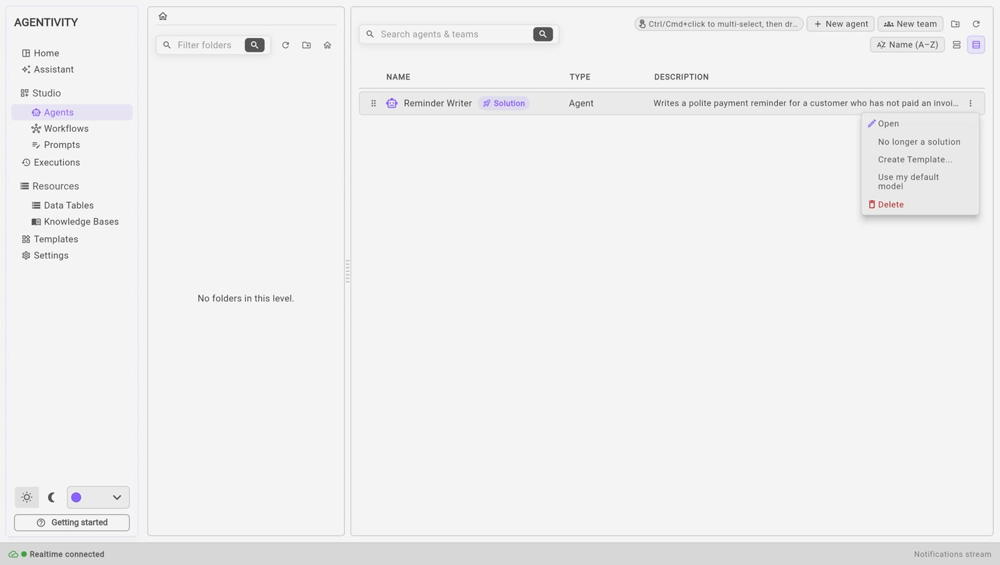
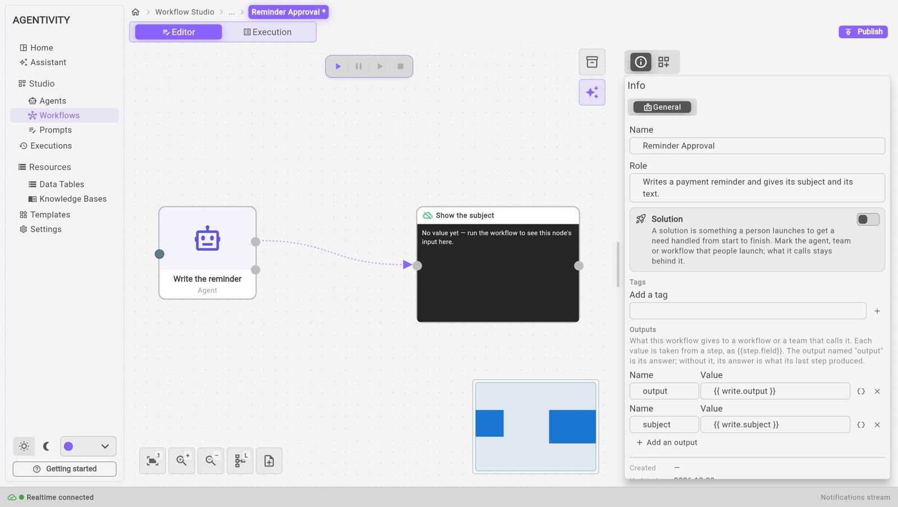

<!-- GENERATED from agentivity_docs/fr/introduction/what-a-solution-is.md. Do not edit here: edit the source and publish again. -->

La Solution est l'idée centrale d'Agentivity. Ce n'est pas une fonction du portail : tout l'espace de travail sait lesquels de vos agents, équipes et workflows sont des Solutions, et le Studio lui-même les met en évidence. Cette page dit ce qu'est une Solution, ce qu'il faut marquer comme tel, et comment le marquer dans le Studio.

## Ce qu'est une Solution

Une solution, c'est quelque chose qu'une personne lance pour faire traiter un besoin du début à la fin. La personne fait une demande et reçoit un travail terminé. En dessous, une solution est un agent, une équipe ou un workflow. La personne qui l'utilise n'a pas besoin de savoir lequel.

Ce qui fait d'un élément une Solution, c'est un tag : le tag `solution`, posé sur un agent, une équipe ou un workflow. Il n'y a pas d'autre moyen de créer une Solution. Marquer une Solution ne fait qu'ajouter le tag, et la démarquer ne fait que le retirer. Rien d'autre ne change : elle n'est ni publiée ni partagée, et elle ne tourne pas autrement.

Les tags sont toujours conservés en minuscules. Si vous tapez `Solution` dans le Studio, Agentivity garde `solution`.

## Quoi marquer, et quoi ne pas marquer

Marquez ce qu'une personne lance. Ce qu'il appelle reste derrière. Le Studio le dit en une phrase :

> Mark the agent, team or workflow that people launch; what it calls stays behind it.

Autrement dit : marquez l'agent, l'équipe ou le workflow que les gens lancent ; ce qu'il appelle reste derrière lui.

Dans notre exemple, l'équipe `Payment Reminders` compte deux agents. Une personne lance l'équipe : c'est donc l'équipe qui est la Solution. Les deux agents sont ses membres : ils ne sont pas marqués.

C'est la même chose pour un workflow. Marquez le workflow que les gens démarrent. Ne marquez pas les workflows qu'il appelle pour faire une partie du travail.

Un agent peut aussi être une Solution, quand une personne le lance directement et qu'aucune équipe ne se trouve devant lui.

## Marquer une Solution, ou retirer la marque

Vous pouvez le faire depuis une bibliothèque ou depuis un éditeur.

### Depuis une bibliothèque

1. Ouvrez **Studio** > **Agents** pour un agent ou une équipe, ou **Studio** > **Workflows** pour un workflow.
2. Sur la ligne de l'agent, de l'équipe ou du workflow, sélectionnez les trois points.
3. Sélectionnez **Mark as solution**.

Quand c'est déjà une Solution, la même entrée indique **No longer a solution**. Sélectionnez-la pour retirer la marque.

Cela ne change que les tags. Vous n'avez pas besoin de publier.

### Depuis un éditeur

1. Ouvrez l'agent, l'équipe ou le workflow dans son éditeur.
2. Dans le panneau **Info**, à droite, repérez l'encadré **Solution**. Il se trouve au-dessus de **Tags**.
3. Activez ou désactivez l'interrupteur.
4. Sélectionnez **Publish**.

La modification est enregistrée avec le reste de l'éditeur. L'encadré explique ce qu'est une Solution, avec la même phrase que ci-dessus.

Vous pouvez aussi taper le tag `solution` à la main dans **Tags**. C'est la même chose : l'interrupteur ne fait qu'ajouter ou retirer ce tag. Voyez [Afficher une équipe dans le portail](/fr/docs/vibeapps/show-a-solution-in-the-portal/).

## Comment une Solution apparaît dans le Studio

Dans **Agents** et dans **Workflows**, une Solution se distingue du reste :

- une petite marque **Solution** figure à côté de son nom ;
- son icône prend la couleur d'accent.

Si vous laissez le pointeur sur la marque, elle explique ce qu'est une Solution.

## Où les Solutions apparaissent

| Où | Ce qui se passe |
|---|---|
| **Les bibliothèques** | La marque à côté du nom, comme ci-dessus. |
| **Le portail, et les apps que vous construisez** | Le portail est une application en marque blanche : les gens peuvent l'utiliser telle quelle, ou l'adapter. Il trouve les Solutions de votre espace de travail grâce à ce tag, et rien d'autre. Une app à vous peut faire de même. Voyez [Afficher une équipe dans le portail](/fr/docs/vibeapps/show-a-solution-in-the-portal/) et [Lister les solutions et lancer une exécution depuis votre app](/fr/docs/vibeapps/run-a-solution-from-your-app/). |
| **Un Template** | Un Template a toujours une Solution en son cœur. Quand le Template est créé, son agent, son équipe ou son workflow principal porte le tag. Ce que vous importez depuis un Template apparaît donc comme une Solution dans votre bibliothèque. Voyez [Partager votre travail sous forme de Template](/fr/docs/guides/share-a-template/). |
| **Ce que construit l'Assistant** | L'Assistant enregistre son travail avec l'agent, l'équipe ou le workflow principal marqué comme Solution. Voyez [Construire votre première équipe avec l'Assistant](/fr/docs/getting-started/build-your-first-team-with-the-assistant/). |

## Comment savoir que ça marche

Dans la bibliothèque, la ligne de l'agent, de l'équipe ou du workflow affiche la marque **Solution** à côté de son nom, et son menu propose désormais **No longer a solution**.

Dans un éditeur, l'interrupteur de l'encadré **Solution** est activé, et le tag `solution` figure sous **Tags**.

Un portail ou une app le liste une fois sa page rechargée.

## Bon à savoir

- Marquer une Solution ne la publie pas, ne la partage pas et ne change pas sa façon de tourner. Cela ajoute un tag.
- Une équipe est une seule Solution, quel que soit le nombre de ses membres. Marquez l'équipe, pas chaque membre.
- Pour ne plus lister un élément dans un portail, retirez sa marque.

## Étape suivante

[Ce que vous pouvez faire avec Agentivity](/fr/docs/introduction/what-you-can-do-with-it/).
